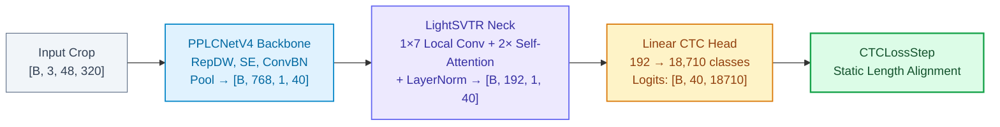

# OCRtorch

[](https://www.python.org/)
[](https://pytorch.org/)
[](#numerical-parity-verification)
[](https://pytorch.org/blog/introducing-torchtpu/)

**OCRtorch** is a clean, modular PyTorch implementation of the [PP-OCRv6](https://arxiv.org/abs/2606.13108) text recognition and detection stack (`PP_OCRv6MediumRec` and `PP_OCRv6MediumDet`). It delivers verified token-for-token numerical parity with PaddleOCR reference weights, reproducible preprocessing, CTC fine-tuning with early stopping, and static-shape execution across **CPU**, **Apple Silicon MPS**, and **Google Cloud TPUs** via [TorchTPU](https://pytorch.org/blog/introducing-torchtpu/).

[Installation](#installation) • [Quick Start](#quick-start) • [CLI & Configs](#cli--config-reference) • [Architecture](#architecture-overview) • [Parity](#numerical-parity-verification) • [Contributing](#contributing)

---

## Key Features

- **Exact PaddleOCR parity:** Aligns tensor layouts, asymmetric even-kernel padding, valid-window pooling, and normalization epsilons to match Paddle reference activations across all 16 intermediate stages (`40/40` argmax tokens).
- **One codebase, every accelerator:** Runs the same model and training loop on CPU, Apple Silicon MPS (with automatic CPU fallback for `nn.CTCLoss`), CUDA, and Cloud TPUs (`torch.device("tpu")`).
- **TorchTPU-ready static shapes:** Pads image batches to `[B, 3, 48, 320]` with fixed `input_lengths = 40`, static target padding, and hybrid `bfloat16` autocast (`float32` master weights and optimizer states).
- **Batteries-included CLIs:** Convert PaddleOCR 3.x PIR weights, evaluate checkpoints, fine-tune with YAML presets, run detection + recognition inference, and launch Colab TPU jobs.

---

## Architecture Overview



---

## Installation

OCRtorch requires **Python 3.11+**. Dependencies are managed in [pyproject.toml](pyproject.toml) (no `requirements.txt` is needed).

### Standard Environment (`pip` / `.venv`)

```bash
git clone https://github.com/<your-org>/ocrtorch.git
cd ocrtorch
pip install -e ".[dev]"
```

Optional extras:

```bash
pip install -e ".[dev,cloud]"   # Google Auth & GCS utilities
pip install -e ".[tpu]"         # TorchTPU (torch-tpu) backend
```

### Preconfigured `torch-tpu` Conda Environment (TPU VMs)

If you are using a `torch-tpu` conda environment (which already provides `torch`, `torchvision`, `torch_tpu`, `libtpu`, `numpy`, `pillow`, and `PyYAML`), install with `--no-deps` so `pip` preserves the preinstalled `torch`/`torch_tpu` packages:

```bash
conda activate torch-tpu
pip install --no-build-isolation --no-deps -e .
pip install pytest  # Optional: to run the test suite
```

---

## Quick Start

### 1. Convert PaddleOCR Weights to PyTorch

Convert a PaddleOCR 3.x PIR model directory (containing `inference.json` and `inference.pdiparams`) or exported `.npz` weights into a PyTorch `state_dict`:

```bash
ocrtorch-convert \
  --input path/to/PP-OCRv6_medium_rec \
  --output artifacts/ppocrv6_medium_rec.pt
```

> [!NOTE]
> Keep PaddleOCR's `inference.yml` (e.g., copy it to `artifacts/inference.yml`). The `.pt` checkpoint stores only model weights, while `inference.yml` provides the `18,709`-character dictionary (+ CTC blank ID `0` = `18,710` classes) used for label encoding and greedy decoding.

### 2. Run Zero-Shot (or Post-Training) Evaluation

Evaluate any checkpoint against a CSV label file (`Images,Text` columns) or a JSONL manifest (`{"image": ..., "text": ...}`):

```bash
ocrtorch-evaluate \
  --checkpoint artifacts/ppocrv6_medium_rec.pt \
  --inference-yaml artifacts/inference.yml \
  --csv path/to/Test_Labels.csv \
  --image-dir path/to/Test_Set \
  --device auto \
  --batch-size 64 \
  --num-workers 4
```

- Pass `--manifest path/to/validation.jsonl` (instead of `--csv` and `--image-dir`) to evaluate a JSONL split.
- Pass `--predictions-csv path/to/predictions.csv` to export per-image predictions alongside summary metrics (Raw/Normalized Exact Match, CER, WER, throughput).

### 3. Fine-Tune Locally (CPU or Apple Silicon MPS)

`ocrtorch-train` supports YAML presets (`--config`, with CLI flags overriding YAML values), validation CER monitoring, linear warmup + cosine LR decay, automatic checkpointing (`best_model.pt` and `latest_model.pt`), and early stopping:

```bash
ocrtorch-train \
  --config configs/local_mps.yaml \
  --checkpoint artifacts/ppocrv6_medium_rec.pt \
  --inference-yaml artifacts/inference.yml \
  --train-manifest path/to/train.jsonl \
  --val-manifest path/to/validation.jsonl \
  --output-dir artifacts/checkpoints/finetuned_mps
```

Convenience wrapper scripts are available in `scripts/`:

```bash
./scripts/finetune-mps.sh      # Apple Silicon MPS (configs/local_mps.yaml)
./scripts/finetune-cpu.sh      # Multi-core CPU (configs/local_cpu.yaml)
```

### 4. Fine-Tune on Google Cloud TPU (`TorchTPU`)

On Cloud TPUs (`v4`, `v5e`, `v5p`, `v6e`) with `torch_tpu`, `ocrtorch-train --device tpu` automatically enables **hybrid `bfloat16` autocast** (keeping `float32` master weights and AdamW states while running `Conv2d`/`Linear` ops in `bfloat16`), static target padding (`--max-target-len 40`), and `drop_last=True`:

```bash
# Option A: One-command VM staging + training
./scripts/setup-tpu-vm.sh      # Activates torch-tpu (or .venv), verifies TPU, stages data into data/tpu/
./scripts/finetune-tpu-vm.sh   # Launches ocrtorch-train with configs/tpu_v6e.yaml

# Option B: Direct CLI invocation
ocrtorch-train \
  --config configs/tpu_v6e.yaml \
  --checkpoint artifacts/ppocrv6_medium_rec.pt \
  --inference-yaml artifacts/inference.yml \
  --train-manifest path/to/train.jsonl \
  --val-manifest path/to/validation.jsonl \
  --output-dir artifacts/checkpoints/finetuned_tpu_v6e
```

Or use `PP_OCRv6MediumRec` and `CTCLossStep` directly in Python:

```python
import torch
import torch_tpu  # noqa: F401
from ocrtorch.models.ppocrv6 import PP_OCRv6MediumRec
from ocrtorch.train.loss import CTCLossStep

device = torch.device("tpu")
model = PP_OCRv6MediumRec().to(device)
optimizer = torch.optim.AdamW(model.parameters(), lr=4e-5)
criterion = CTCLossStep().to(device)

images = torch.randn(64, 3, 48, 320, device=device)
targets = torch.randint(1, 18700, (64, 40), dtype=torch.long)
input_lengths = torch.full((64,), 40, dtype=torch.long)
target_lengths = torch.full((64,), 20, dtype=torch.long)

with torch.autocast("tpu", dtype=torch.bfloat16):
    logits = model(images)
loss = criterion(logits.float(), targets, input_lengths, target_lengths)
loss.backward()
optimizer.step()
```

### 5. Launch Cloud TPU Fine-Tuning via Colab CLI

To run training on a Google Colab TPU runtime (`tpuv6e`, `v6e`, `v6e1`, `v5e1`) from your local terminal:

1. Install cloud dependencies (`pip install -e ".[cloud]"`).
2. Ensure the Google Colab CLI (`colab`) is authenticated and on `PATH`.
3. Configure Application Default Credentials (`gcloud auth application-default login`) for GCS access.
4. Prepare local manifests (`train.jsonl`, `validation.jsonl`, `split_metadata.json`).

```bash
ocrtorch-colab \
  --model-gcs gs://<your-bucket>/model-dir \
  --dataset-gcs gs://<your-bucket>/dataset-dir \
  --manifests-dir path/to/manifests \
  --tpu tpuv6e \
  --epochs 20 \
  --batch-size 8 \
  --lr 1e-5 \
  --patience 3
```

---

## CLI & Config Reference

| Entry Point | Purpose |
| :--- | :--- |
| `ocrtorch-convert` | Convert PaddleOCR 3.x PIR directory or `.npz` weights to `.pt` |
| `ocrtorch-convert-det` | Convert PP-OCRv6 detection `.npz` weights to `.pt` |
| `ocrtorch-evaluate` | Evaluate `.pt` checkpoints on CSV or JSONL splits |
| `ocrtorch-train` | Fine-tune `PP_OCRv6MediumRec` with early stopping & YAML presets |
| `ocrtorch-predict` | Run end-to-end detection + recognition or `--crop-only` inference |
| `ocrtorch-colab` | Provision and run TPU fine-tuning on Google Colab |

| Config Preset | Target Backend | Key Defaults |
| :--- | :--- | :--- |
| [configs/local_cpu.yaml](configs/local_cpu.yaml) | CPU | `bf16: true`, `batch_size: 64`, `lr: 4e-5` |
| [configs/local_mps.yaml](configs/local_mps.yaml) | Apple Silicon MPS | `bf16: false`, `batch_size: 64`, `lr: 4e-5` |
| [configs/tpu_v6e.yaml](configs/tpu_v6e.yaml) | Cloud TPU (`TorchTPU`) | `bf16: true`, `max_target_len: 40`, `drop_last: true` |

---

## Numerical Parity Verification

OCRtorch is verified against Paddle reference activations across all 16 intermediate stages in [tests/test_parity.py](tests/test_parity.py):

| Stage | Output Shape | Max Absolute Diff | Mean Absolute Diff |
| :--- | :---: | :---: | :---: |
| `backbone_stem` | `[1, 128, 12, 80]` | $4.00 \times 10^{-5}$ | $8.89 \times 10^{-7}$ |
| `backbone_blocks2` | `[1, 128, 12, 80]` | $1.06 \times 10^{-5}$ | $3.13 \times 10^{-7}$ |
| `backbone_blocks3` | `[1, 256, 12, 80]` | $9.04 \times 10^{-6}$ | $3.57 \times 10^{-7}$ |
| `backbone_blocks4` | `[1, 512, 6, 80]` | $1.40 \times 10^{-5}$ | $6.97 \times 10^{-7}$ |
| `backbone_blocks5` | `[1, 768, 3, 80]` | $5.26 \times 10^{-5}$ | $2.14 \times 10^{-6}$ |
| `backbone_pool` | `[1, 768, 1, 40]` | $2.71 \times 10^{-5}$ | $1.69 \times 10^{-6}$ |
| `neck_reduce` | `[1, 192, 1, 40]` | $8.58 \times 10^{-6}$ | $7.72 \times 10^{-7}$ |
| `neck_local` | `[1, 192, 1, 40]` | $1.12 \times 10^{-5}$ | $5.12 \times 10^{-7}$ |
| `neck_local_sum` | `[1, 192, 1, 40]` | $1.20 \times 10^{-5}$ | $1.09 \times 10^{-6}$ |
| `neck_block_0` | `[1, 40, 192]` | $1.23 \times 10^{-5}$ | $2.36 \times 10^{-6}$ |
| `neck_block_1` | `[1, 40, 192]` | $1.95 \times 10^{-5}$ | $3.42 \times 10^{-6}$ |
| `neck_norm` | `[1, 40, 192]` | $8.10 \times 10^{-5}$ | $7.78 \times 10^{-6}$ |
| `neck_out` | `[1, 192, 1, 40]` | $8.89 \times 10^{-5}$ | $9.34 \times 10^{-6}$ |
| `sequence` | `[1, 40, 192]` | $8.89 \times 10^{-5}$ | $9.34 \times 10^{-6}$ |
| `ctc_logits` | `[1, 40, 18710]` | $8.42 \times 10^{-5}$ | $6.49 \times 10^{-6}$ |
| `probabilities` | `[1, 40, 18710]` | $2.90 \times 10^{-5}$ | $1.08 \times 10^{-9}$ |
| **Argmax Token Agreement** | **40 / 40 steps** | — | **100.00%** |

---

## Testing

Run the full test suite (requires `[dev,cloud]` extras and parity artifacts):

```bash
pytest tests/ -v
```

Or run the core unit tests in a minimal `torch-tpu` environment:

```bash
pytest tests/ \
  --ignore=tests/test_colab_launcher.py \
  --ignore=tests/test_evaluate_gemini.py \
  --ignore=tests/test_pipeline.py \
  --ignore=tests/test_parity.py \
  -k "not test_gcs_client_tracks_token_expiry_and_consumes_secrets_from_config and not test_det_forward_shape_and_range" \
  -v
```

---

## Contributing

Contributions are welcome! Whether you are fixing an operator mismatch, adding a benchmark, or extending backend support:

1. Open an issue to discuss the proposed change or report a bug.
2. Fork the repository and create a focused feature branch.
3. Add or update tests in `tests/` and verify that `pytest` passes.
4. Open a pull request with a clear summary of your changes and any relevant benchmark or parity results.
