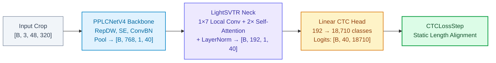

# OCRtorch: High-Fidelity PyTorch Port of PP-OCRv6 for TorchTPU

[](https://pytorch.org/)
[](#numerical-parity-verification)
[](https://pytorch.org/blog/introducing-torchtpu/)

**OCRtorch** is a high-fidelity, modular PyTorch implementation of Baidu's production-grade [PP-OCRv6](https://arxiv.org/abs/2606.13108) text recognition architecture. Developed for the **TorchTPU Sprint**, OCRtorch provides exact mathematical parity against Paddle reference weights, reproducible data preprocessing, early stopping fine-tuning, and static-sequence compilation design optimized for local hardware (CPU & Apple Silicon MPS) and Google Cloud TPUs via [TorchTPU](https://pytorch.org/blog/introducing-torchtpu/).

---

## Architecture Overview



---

## Numerical Parity Verification

OCRtorch was verified against reference activations across all 16 intermediate stages using `tests/test_parity.py`:

| Stage | Output Shape | Max Absolute Diff | Mean Absolute Diff |
| :--- | :---: | :---: | :---: |
| `backbone_stem` | `[1, 128, 12, 80]` | $4.00 \times 10^{-5}$ | $8.89 \times 10^{-7}$ |
| `backbone_blocks2` | `[1, 128, 12, 80]` | $1.06 \times 10^{-5}$ | $3.13 \times 10^{-7}$ |
| `backbone_blocks3` | `[1, 256, 12, 80]` | $9.04 \times 10^{-6}$ | $3.57 \times 10^{-7}$ |
| `backbone_blocks4` | `[1, 512, 6, 80]` | $1.40 \times 10^{-5}$ | $6.97 \times 10^{-7}$ |
| `backbone_blocks5` | `[1, 768, 3, 80]` | $5.26 \times 10^{-5}$ | $2.14 \times 10^{-6}$ |
| `backbone_pool` | `[1, 768, 1, 40]` | $2.71 \times 10^{-5}$ | $1.69 \times 10^{-6}$ |
| `neck_reduce` | `[1, 192, 1, 40]` | $8.58 \times 10^{-6}$ | $7.72 \times 10^{-7}$ |
| `neck_local` | `[1, 192, 1, 40]` | $1.12 \times 10^{-5}$ | $5.12 \times 10^{-7}$ |
| `neck_local_sum` | `[1, 192, 1, 40]` | $1.20 \times 10^{-5}$ | $1.09 \times 10^{-6}$ |
| `neck_block_0` | `[1, 40, 192]` | $1.23 \times 10^{-5}$ | $2.36 \times 10^{-6}$ |
| `neck_block_1` | `[1, 40, 192]` | $1.95 \times 10^{-5}$ | $3.42 \times 10^{-6}$ |
| `neck_norm` | `[1, 40, 192]` | $8.10 \times 10^{-5}$ | $7.78 \times 10^{-6}$ |
| `neck_out` | `[1, 192, 1, 40]` | $8.89 \times 10^{-5}$ | $9.34 \times 10^{-6}$ |
| `sequence` | `[1, 40, 192]` | $8.89 \times 10^{-5}$ | $9.34 \times 10^{-6}$ |
| `ctc_logits` | `[1, 40, 18710]` | $8.42 \times 10^{-5}$ | $6.49 \times 10^{-6}$ |
| `probabilities` | `[1, 40, 18710]` | $2.90 \times 10^{-5}$ | $1.08 \times 10^{-9}$ |
| **Argmax Token Agreement** | **40 / 40 steps** | — | **100.00%** |

---

## Local Fine-Tuning (CPU & Apple Silicon MPS)

The package includes CLI tooling and shell scripts supporting **Early Stopping** (monitoring validation Character Error Rate) and automatic checkpointing (`best_model.pt` and `latest_model.pt`).

### Option 1: Apple Silicon GPU (MPS) - Highly Recommended for Mac
Runs all 34.5M parameters on MPS with transparent CPU CTC loss fallback:
```bash
conda activate torch-env
./scripts/finetune-mps.sh
```
Or directly via the CLI:
```bash
ocrtorch-train \
  --checkpoint artifacts/ppocrv6_medium_rec.pt \
  --inference-yaml ~/.paddlex/official_models/PP-OCRv6_medium_rec/inference.yml \
  --train-manifest ../ocrax/data/manifests/train.jsonl \
  --val-manifest ../ocrax/data/manifests/validation.jsonl \
  --output-dir artifacts/checkpoints/finetuned_mps \
  --device mps \
  --epochs 20 \
  --batch-size 8 \
  --lr 1e-5 \
  --patience 3
```

### Option 2: CPU
```bash
./scripts/finetune-cpu.sh
```

---

## Running Unit and Parity Tests

```bash
pytest tests/ -v
```

---

## TorchTPU Execution Guide

To train or fine-tune PP-OCRv6 on Google Cloud TPUs (`v4`, `v5e`, `v5p`, or `v6e`) using TorchTPU:

```python
import torch
import torch_tpu
from ocrtorch.models.ppocrv6 import PP_OCRv6MediumRec
from ocrtorch.train.loss import CTCLossStep

# 1. Select the native TPU device
device = torch.device("tpu")

# 2. Instantiate and compile model
model = PP_OCRv6MediumRec().to(device)
compiled_model = torch.compile(model, backend="openxla")

# 3. Setup optimizer and static loss step
optimizer = torch.optim.AdamW(compiled_model.parameters(), lr=1e-4)
criterion = CTCLossStep().to(device)

# 4. Forward & backward step with static shapes
images = torch.randn(16, 3, 48, 320, device=device)
targets = torch.randint(1, 18700, (16, 20), device=device)
input_lengths = torch.full((16,), 40, dtype=torch.long, device=device)
target_lengths = torch.full((16,), 20, dtype=torch.long, device=device)

logits = compiled_model(images)
loss = criterion(logits, targets, input_lengths, target_lengths)
loss.backward()
optimizer.step()
```
