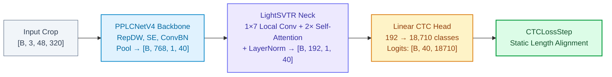

# OCRtorch

[](https://pytorch.org/)
[](#numerical-parity-verification)
[](https://pytorch.org/blog/introducing-torchtpu/)

**OCRtorch** is a modular PyTorch implementation of the [PP-OCRv6](https://arxiv.org/abs/2606.13108) text recognition architecture (`PP_OCRv6MediumRec`). It provides verified numerical parity against Paddle reference weights, reproducible image preprocessing, CTC fine-tuning with early stopping, and static-shape execution across CPU, Apple Silicon MPS, and Google Cloud TPUs via [TorchTPU](https://pytorch.org/blog/introducing-torchtpu/).

---

## Key Capabilities

- **Exact reference parity:** Aligns tensor layouts, asymmetric even-kernel padding, valid-window pooling, and normalization epsilons to match Paddle reference activations across all 16 intermediate stages.
- **Multi-backend training:** Runs the same PyTorch model and training loop on CPU, Apple Silicon MPS (with a CPU fallback bridge for `nn.CTCLoss`), and Cloud TPUs (`torch.device("tpu")`).
- **Static-shape pipeline:** Pads batches to fixed `[B, 3, 48, 320]` inputs with `input_lengths = 40` for XLA and `torch.compile` compatibility.
- **CLI tooling:** Includes entry points for weight conversion (`ocrtorch-convert`), training (`ocrtorch-train`), and cloud orchestration (`ocrtorch-colab`).

---

## Architecture Overview



---

## Installation

OCRtorch requires **Python 3.11+**. Install the package in editable mode from the repository root:

```bash
pip install -e ".[dev]"
```

Optional extras are available for cloud storage orchestration and TPU execution:

```bash
pip install -e ".[dev,cloud]"   # Google Auth and GCS utilities
pip install -e ".[tpu]"         # TorchTPU (torch-tpu) backend
```

---

## Quick Start

### 1. Weight Conversion

Convert flattened Paddle/JAX parameter arrays (`.npz`) to a PyTorch `state_dict` (`.pt`):

```bash
ocrtorch-convert --input path/to/weights.npz --output artifacts/ppocrv6_medium_rec.pt
```

### 2. Local Fine-Tuning (CPU & Apple Silicon MPS)

The training CLI supports YAML configuration presets (`--config`, with CLI flags overriding YAML values), validation CER monitoring, automatic checkpointing (`best_model.pt` and `latest_model.pt`), linear warmup + cosine LR decay, and early stopping.

Run on Apple Silicon MPS (with CPU fallback for `nn.CTCLoss`):

```bash
ocrtorch-train \
  --config configs/local_mps.yaml \
  --checkpoint artifacts/ppocrv6_medium_rec.pt \
  --inference-yaml path/to/inference.yml \
  --train-manifest path/to/train.jsonl \
  --val-manifest path/to/validation.jsonl \
  --output-dir artifacts/checkpoints/finetuned_mps
```

Convenience wrapper scripts are also available in `scripts/`:

```bash
./scripts/finetune-mps.sh   # Apple Silicon MPS
./scripts/finetune-cpu.sh   # Multi-core CPU
./scripts/finetune-tpu-vm.sh  # Google Cloud TPU VM (uses configs/tpu_v6e.yaml)
```

### 3. TorchTPU Execution

On Google Cloud TPUs (`v4`, `v5e`, `v5p`, or `v6e`) with `torch_tpu` installed, `ocrtorch-train --device tpu` automatically enables **hybrid `bfloat16` autocast** (keeping `float32` master weights and AdamW states while running `Conv2d`/`Linear` ops in `bfloat16`), static target padding (`--max-target-len 40`), and `drop_last=True`:

```bash
ocrtorch-train \
  --config configs/tpu_v6e.yaml \
  --checkpoint artifacts/ppocrv6_medium_rec.pt \
  --inference-yaml path/to/inference.yml \
  --train-manifest path/to/train.jsonl \
  --val-manifest path/to/validation.jsonl \
  --output-dir artifacts/checkpoints/finetuned_tpu_v6e
```

Or in Python directly with `torch.device("tpu")` and `torch.autocast("tpu", dtype=torch.bfloat16)`:

```python
import torch
import torch_tpu  # noqa: F401
from ocrtorch.models.ppocrv6 import PP_OCRv6MediumRec
from ocrtorch.train.loss import CTCLossStep

# 1. Select the native TPU device (float32 master weights)
device = torch.device("tpu")
model = PP_OCRv6MediumRec().to(device)

# 2. Configure optimizer and static-shape float32 CTC loss
optimizer = torch.optim.AdamW(model.parameters(), lr=4e-5)
criterion = CTCLossStep().to(device)

# 3. Hybrid bfloat16 autocast forward + float32 CTC loss & backward
images = torch.randn(64, 3, 48, 320, device=device)
targets = torch.randint(1, 18700, (64, 40), dtype=torch.long)
input_lengths = torch.full((64,), 40, dtype=torch.long)
target_lengths = torch.full((64,), 20, dtype=torch.long)

with torch.autocast("tpu", dtype=torch.bfloat16):
    logits = model(images)
loss = criterion(logits.float(), targets, input_lengths, target_lengths)
loss.backward()
optimizer.step()
```

### 4. Cloud TPU Fine-Tuning via Colab CLI

To launch fine-tuning on a Google Colab TPU runtime from your local terminal, ensure:
1. Cloud dependencies are installed (`pip install -e ".[cloud]"`).
2. The Google Colab CLI (`colab`) is installed, authenticated, and available on `PATH`.
3. Google Application Default Credentials are configured (`gcloud auth application-default login`) for GCS access.
4. Local manifests (`train.jsonl`, `validation.jsonl`, `split_metadata.json`) exist under `data/manifests/` (or pass `--manifests-dir`).

Run `ocrtorch-colab` (supported `--tpu` values: `tpuv6e`, `v6e`, `v6e1`, `v5e1`):

```bash
ocrtorch-colab \
  --model-gcs gs://<your-bucket>/model-dir \
  --dataset-gcs gs://<your-bucket>/dataset-dir \
  --manifests-dir path/to/manifests \
  --tpu tpuv6e \
  --epochs 20 \
  --batch-size 8 \
  --lr 1e-5 \
  --patience 3
```

Or use the convenience wrapper script:

```bash
./scripts/finetune-colab-tpu.sh
```

The launcher provisions a Colab TPU runtime, installs `torch-tpu`, stages the checkpoint and dataset from GCS, runs `ocrtorch-train --device tpu`, uploads checkpoints (`best_model.pt`, `latest_model.pt`, and `training_summary.json`) to `<model-gcs>/finetuned-runs/`, and stops the Colab session on completion.

---

## Numerical Parity Verification

OCRtorch is verified against reference activations across all 16 intermediate stages in `tests/test_parity.py`:

| Stage | Output Shape | Max Absolute Diff | Mean Absolute Diff |
| :--- | :---: | :---: | :---: |
| `backbone_stem` | `[1, 128, 12, 80]` | $4.00 \times 10^{-5}$ | $8.89 \times 10^{-7}$ |
| `backbone_blocks2` | `[1, 128, 12, 80]` | $1.06 \times 10^{-5}$ | $3.13 \times 10^{-7}$ |
| `backbone_blocks3` | `[1, 256, 12, 80]` | $9.04 \times 10^{-6}$ | $3.57 \times 10^{-7}$ |
| `backbone_blocks4` | `[1, 512, 6, 80]` | $1.40 \times 10^{-5}$ | $6.97 \times 10^{-7}$ |
| `backbone_blocks5` | `[1, 768, 3, 80]` | $5.26 \times 10^{-5}$ | $2.14 \times 10^{-6}$ |
| `backbone_pool` | `[1, 768, 1, 40]` | $2.71 \times 10^{-5}$ | $1.69 \times 10^{-6}$ |
| `neck_reduce` | `[1, 192, 1, 40]` | $8.58 \times 10^{-6}$ | $7.72 \times 10^{-7}$ |
| `neck_local` | `[1, 192, 1, 40]` | $1.12 \times 10^{-5}$ | $5.12 \times 10^{-7}$ |
| `neck_local_sum` | `[1, 192, 1, 40]` | $1.20 \times 10^{-5}$ | $1.09 \times 10^{-6}$ |
| `neck_block_0` | `[1, 40, 192]` | $1.23 \times 10^{-5}$ | $2.36 \times 10^{-6}$ |
| `neck_block_1` | `[1, 40, 192]` | $1.95 \times 10^{-5}$ | $3.42 \times 10^{-6}$ |
| `neck_norm` | `[1, 40, 192]` | $8.10 \times 10^{-5}$ | $7.78 \times 10^{-6}$ |
| `neck_out` | `[1, 192, 1, 40]` | $8.89 \times 10^{-5}$ | $9.34 \times 10^{-6}$ |
| `sequence` | `[1, 40, 192]` | $8.89 \times 10^{-5}$ | $9.34 \times 10^{-6}$ |
| `ctc_logits` | `[1, 40, 18710]` | $8.42 \times 10^{-5}$ | $6.49 \times 10^{-6}$ |
| `probabilities` | `[1, 40, 18710]` | $2.90 \times 10^{-5}$ | $1.08 \times 10^{-9}$ |
| **Argmax Token Agreement** | **40 / 40 steps** | — | **100.00%** |

---

## Testing

Run the full unit, parity, and cloud-orchestration test suite:

```bash
pytest tests/ -v
```

---

## Contributing

Contributions are welcome. If you plan to add a feature, fix an operator mismatch, or benchmark another backend:

1. Open an issue to discuss the proposed change or report a bug.
2. Fork the repository and create a focused feature branch.
3. Add or update tests in `tests/` and verify that `pytest tests/ -v` passes.
4. Submit a pull request with a clear summary of your changes and any relevant benchmark or parity results.
