# Benchmark Report: PP-OCRv6 CPU vs. Apple Silicon MPS Throughput

**Date:** 2026-11-05  
**Hardware Environment:** Apple M4 Pro (12 CPU cores, Metal Performance Shaders GPU, 24 GB Unified Memory)  
**Software Stack:** macOS, Python 3.13.15, PyTorch 2.10.0 (`torch-env`), Metal backend  
**Model:** `PP_OCRv6MediumRec` (~34.5M parameters, PPLCNetV4 backbone + LightSVTR neck + Linear CTC head, vocabulary: 18,710 classes)

---

## 1. Executive Summary

Empirical benchmarking was conducted on **Apple M4 Pro** comparing **CPU** (multi-threaded AVX/Neon execution) versus **MPS** (Apple Silicon Metal Performance Shaders GPU) for both single-sample/batched inference and full fine-tuning backward steps.

```mermaid
xychart-beta
    title "Training Step Throughput (Images / Second) - Batch 8 & 16"
    x-axis ["Batch 8", "Batch 16"]
    y-axis "Images / Sec" 0 --> 70
    bar [0.62, 0.73]
    bar [63.59, 57.86]
```



### Key Takeaways
1. **Training Acceleration (102.6× Speedup):**  
   At batch size 8, a complete fine-tuning step (forward pass, hybrid CPU CTC loss, backpropagation, and AdamW optimizer update) takes **125.80 ms on MPS** compared to **12,911.58 ms on CPU**.
2. **Estimated Full Epoch Time on RxHandBD (3,794 training crops):**
   - **Apple Silicon MPS:** **~1.0 minute per epoch** (20 epochs in ~20 minutes).
   - **CPU:** **~1.7 hours per epoch** (20 epochs in ~34 hours).
3. **Inference Acceleration (up to 283.5× Speedup):**  
   Single-crop interactive latency drops from **2,526.37 ms** on CPU down to **8.91 ms** on MPS, enabling real-time edge transcription at >110 frames per second.

---

## 2. Inference Benchmark

Inference was evaluated under float32 precision with fixed input dimensions $[B, 3, 48, 320]$, measuring mean latency across 10 timed iterations following warmup runs, with explicit GPU synchronization (`torch.mps.synchronize()`).

| Batch Size | Metric | CPU (12 Cores) | Apple Silicon MPS | Speedup (MPS vs. CPU) |
| :---: | :--- | :---: | :---: | :---: |
| **1** | **Batch Latency** | 2,526.37 ms | **8.91 ms** | **283.5× faster** |
| | **Per-Crop Latency** | 2,526.37 ms | **8.91 ms** | **283.5× faster** |
| | **Throughput** | 0.40 img/s | **112.21 img/s** | **+111.8 img/s** |
| **8** | **Batch Latency** | 3,778.85 ms | **47.76 ms** | **79.1× faster** |
| | **Per-Crop Latency** | 472.36 ms | **5.97 ms** | **79.1× faster** |
| | **Throughput** | 2.12 img/s | **167.50 img/s** | **+165.4 img/s** |
| **16** | **Batch Latency** | 3,641.86 ms | **98.17 ms** | **37.1× faster** |
| | **Per-Crop Latency** | 227.62 ms | **6.14 ms** | **37.1× faster** |
| | **Throughput** | 4.39 img/s | **162.98 img/s** | **+158.6 img/s** |

> [!TIP]
> For local inference serving on Apple Silicon, **batch size 8** achieves the peak throughput of **167.5 images/second** (5.97 ms per crop).

---

## 3. Fine-Tuning Step Benchmark (Training Loop)

The training step measures the end-to-end workload executed during fine-tuning:
1. `logits = model(images)`
2. `loss = criterion(logits, targets, input_lengths, target_lengths)` (with hybrid CPU bridge for `aten::_ctc_loss`)
3. `loss.backward()` (automatic gradient backprop across all 34.5M parameters on MPS)
4. `torch.nn.utils.clip_grad_norm_(model.parameters(), 5.0)`
5. `optimizer.step()` and `optimizer.zero_grad()`

| Batch Size | Metric | CPU (12 Cores) | Apple Silicon MPS | Speedup (MPS vs. CPU) |
| :---: | :--- | :---: | :---: | :---: |
| **8** | **Step Latency** | 12,911.58 ms | **125.80 ms** | **102.6× faster** |
| | **Training Throughput** | 0.62 img/s | **63.59 img/s** | **102.6× faster** |
| **16** | **Step Latency** | 21,873.26 ms | **276.54 ms** | **79.1× faster** |
| | **Training Throughput** | 0.73 img/s | **57.86 img/s** | **79.1× faster** |

---

## 4. End-to-End RxHandBD Training Time Projection

Based on the official RxHandBD training manifest containing **3,794 line crops**:

| Configuration | Steps per Epoch (Batch 8) | Time per Epoch | 20 Epochs Run Time |
| :--- | :---: | :---: | :---: |
| **CPU** (`--device cpu`) | 475 steps | ~102.2 minutes (~1.7 hrs) | **~34.1 hours** |
| **MPS** (`--device mps`) | 475 steps | **~59.8 seconds (~1.0 min)** | **~20.0 minutes** |

> [!NOTE]
> **Why CPU Training is Slow:**  
> PP-OCRv6 medium has 16 stages of depthwise separable convolutions (`groups=channels`), Squeeze-and-Excitation linear blocks, and multi-head self-attention. On CPU, calculating backpropagation for large vocabulary projections ($192 \times 18,710 = 3.6\text{M}$ weights per step) alongside 16 depthwise conv gradient graphs saturates CPU memory bandwidth, while Apple Silicon's 16-core GPU and 273 GB/s unified memory pipeline executes the matrix multiplications in milliseconds.

---

## 5. Architectural Implementation Notes

### The MPS Hybrid CTC Solution
Because PyTorch 2.10.0 does not yet natively support the dynamic programming operator `aten::_ctc_loss` on Apple Silicon MPS (`NotImplementedError`), `ocrtorch.train.loss.CTCLossStep` automatically bridges the loss computation:
```python
# In ocrtorch/train/loss.py
if logits.device.type == "mps":
    loss = self.criterion(
        log_probs.cpu(),
        targets.cpu(),
        input_lengths.cpu(),
        target_lengths.cpu(),
    )
    return loss.to(logits.device)
```
- The heavy visual backbone, sequence neck, and CTC linear head run forward on **MPS GPU**.
- The tiny CTC loss tensor ($40 \times B \times 18710$) is computed on CPU.
- `loss.backward()` automatically streams the gradients back into MPS memory, enabling full GPU backpropagation and AdamW parameter updates without throwing runtime errors.

---

## 6. How to Reproduce

Run the automated benchmark script inside `torch-env`:

```bash
conda activate torch-env
cd /Users/mghifary/Work/Code/AI/ocr/ocrtorch
python scripts/benchmark.py
```
Results are saved to `artifacts/benchmark_results.json`.
