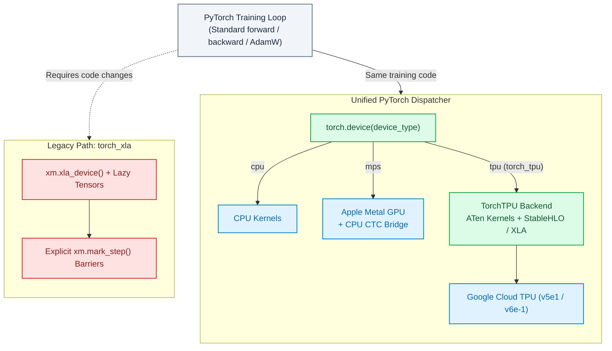
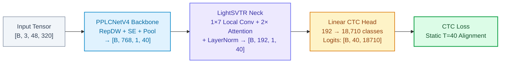
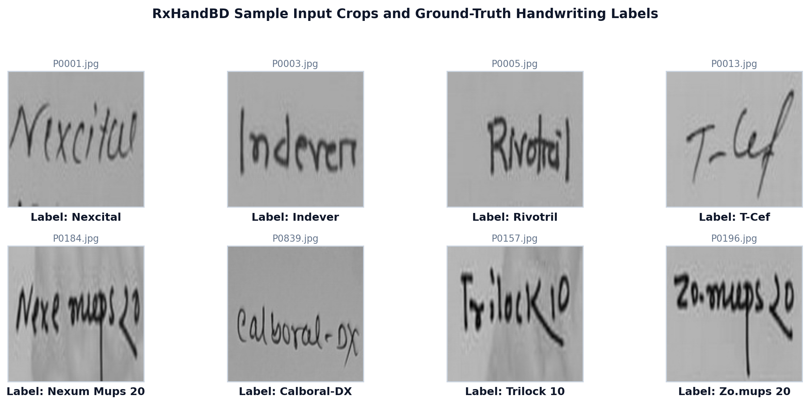
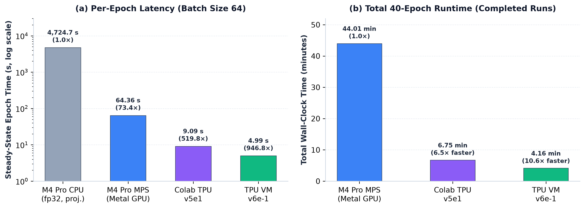
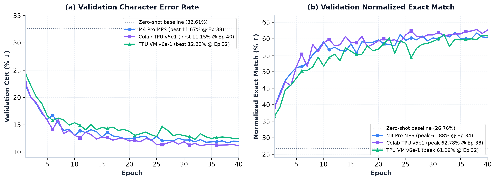
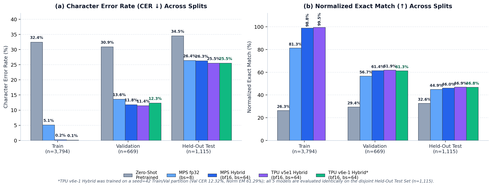

# Scaling Clinical Handwriting OCR in PyTorch: From CPU and Apple Silicon MPS to TorchTPU

**Author:** Muhammad Ghifary  
**Date:** November 21, 2026  
**Series:** Part II — Continuation of [*Building Efficient OCR for Clinical Handwriting with JAX*](https://ghif.github.io/posts/2026-11-12-building-efficient-ocr-clinical-handwriting-jax/)  
**Model:** PP-OCRv6 Medium Recognizer (`PP-OCRv6_medium_rec`)  
**Dataset:** RxHandBD (Handwritten Prescription Line Crops)

---

In the [previous article](https://ghif.github.io/posts/2026-11-12-building-efficient-ocr-clinical-handwriting-jax/) of this series [1], I shared how to port Baidu's `PP-OCRv6_medium_rec` (~34.5M parameters) from PaddlePaddle to JAX/Flax NNX and fine-tune it on handwritten clinical prescriptions using TPUs. Three constraints drove that architecture choice: Protected Health Information (PHI) rules that keep patient records off external cloud APIs, tight edge-compute budgets, and the risk of Vision-Language Models (VLMs) hallucinating medication names.

This article follows the exact same OCR fine-tuning strategy, but shifts the hardware and framework focus from JAX on TPU to **TorchTPU**, i.e., running native PyTorch on Google Cloud TPUs alongside local CPU and Apple Silicon MPS prototyping. The practical question is straightforward: can one static-shape PyTorch codebase match reference `PP-OCRv6_medium_rec` outputs token-for-token, train locally on a MacBook, and scale cleanly to Cloud TPUs via `torch_tpu` without rewriting the training loop?

Under a controlled 40-epoch, batch-size-64 hybrid `bfloat16` recipe on RxHandBD (`3,794` train / `669` validation crops), it is possible to do so. On an Apple M4 Pro, MPS cuts per-epoch latency by **73.4×** over CPU's fastest `fp32` baseline (`64.36 s` vs. `~4,724.7 s` projected from `28.92 s/step`), finishing 40 epochs in **44.01 minutes** and lowering validation Character Error Rate (CER) from the **32.61%** zero-shot baseline to **11.67%**. Running the exact same training loop on Cloud TPUs via `torch-tpu 0.3.0` drops steady-state epoch time to **9.09 s** on Colab `v5e1` (**11.15%** CER, **62.63%** Normalized Exact Match in **6.75 minutes**) and **4.99 s** on TPU VM `v6e-1` (**12.32%** CER in **4.16 minutes**)—a **946.8×** speedup over `fp32` CPU and **12.90×** over MPS, with a **99.9%** XLA compilation cache hit rate.

---

## PyTorch and TorchTPU: One Codebase from Laptop to Cloud

PyTorch's main draw for applied ML work is its unified execution model: you write standard Pythonic tensor code, debug interactively in eager mode, and target CPUs, NVIDIA GPUs, or Apple Silicon GPUs (**MPS**) by changing a device string.

Until recently, Google Cloud TPUs were the exception. Targeting TPUs from PyTorch meant adopting `torch_xla`: a lazy-tensor wrapper that required `xm.xla_device()`, explicit `xm.mark_step()` graph barriers, and careful refactoring to avoid silent CPU fallbacks. Maintaining both standard PyTorch for a MacBook and `torch_xla` for Cloud TPUs added real engineering friction.

Announced in late 2026 by Google and Meta, **TorchTPU** (`torch_tpu`) [4] replaces that wrapper model with a **native PyTorch backend**. Rather than intercepting tensors through a separate lazy-execution layer, `torch_tpu` plugs directly into the **PyTorch dispatcher**, giving TPUs first-class device status (`torch.device("tpu")`) alongside `"cpu"`, `"cuda"`, and `"mps"`:

```python
import torch
import torch_tpu  # Registers the "tpu" backend with the PyTorch dispatcher

device = torch.device("tpu")
```

Figure 1 contrasts the legacy `torch_xla` wrapper path with TorchTPU's native dispatcher integration.


*Figure 1: Legacy `torch_xla` lazy-tensor workflow versus TorchTPU's native PyTorch dispatcher integration alongside CPU and Apple Silicon MPS.*

On Apple Silicon, PyTorch 2.10.0 does not yet implement `aten::_ctc_loss` on MPS. Rather than falling back to CPU for the entire network, our `CTCLossStep` wrapper moves only `log_probs`, `targets`, `input_lengths`, and `target_lengths` to CPU for `nn.CTCLoss` and returns the scalar loss to MPS, keeping all convolutional and attention backpropagation on the Metal GPU.

---

## Inside PP-OCRv6 and Porting Without Drift

`PP-OCRv6_medium_rec` [2] (~34.5M parameters) maps a fixed-size cropped line image $X \in \mathbb{R}^{B \times 3 \times 48 \times 320}$ to frame-level character logits $Z \in \mathbb{R}^{B \times 40 \times 18710}$ across $T=40$ time steps and $V=18{,}710$ classes (`18,709` characters plus CTC blank ID `0`). As shown in Figure 2, it has three stages:


*Figure 2: End-to-end architecture and tensor shape progression of `PP-OCRv6_medium_rec`.*

- **Visual Backbone (`PPLCNetV4`):** Early stem layers downsample both axes ($48 \times 320 \to 12 \times 80$), whereas deeper stages stride only vertically (`(2, 1)`), preserving horizontal resolution ($80 \to 40$ steps after pooling) so adjacent handwritten letters do not smear together. Residual blocks combine reparameterizable depthwise convolutions (`RepDW`), `SqueezeExcite` channel attention, and $1 \times 1$ `GELU` projections.
- **Sequence Neck (`LightSVTR`):** Projects channels from $768 \to 192$, applies a $1 \times 7$ depthwise `SiLU` convolution for local stroke continuity, and runs two multi-head self-attention blocks (8 heads, head dimension 24, MLP ratio 4.0) over $T=40$ steps with a residual projection.
- **CTC Head (`nn.Linear`):** A single $192 \to 18{,}710$ linear projection (~3.59M parameters), whose wide vocabulary matrix drives a large share of memory traffic during backpropagation.

### 1. Weight & Tensor-Layout Conversion (`paddle_to_pt.py`)
Porting the flattened Paddle/JAX checkpoint arrays (`ppocrv6_medium_rec_orbax_flat.npz`) into a PyTorch `state_dict` requires translating both parameter naming conventions and tensor axis layouts:
- **Parameter names:** `kernel` → `weight` (convolutions and linear layers), `scale` / `bias` → `weight` / `bias` (`BatchNorm2d` and `LayerNorm`), and `mean` / `var` → `running_mean` / `running_var` (skipping PyTorch's `num_batches_tracked` buffer).
- **Axis permutations:** 4D convolution kernels use `HWIO` layout in the exported arrays and must be transposed to PyTorch's `OIHW` (`(3, 2, 0, 1)`), while 2D linear weights (`qkv`, `proj`, `fc1`, `fc2`, `ctc`) transpose from `IO` to `OI` (`val.T`).

```python
# src/ocrtorch/convert/paddle_to_pt.py
for k, v in model.state_dict().items():
    if k.endswith(".num_batches_tracked"):
        continue
    parts = k.split(".")
    if parts[-1] == "weight":
        if parts[-2] in ("bn", "identity_bn", "norm", "norm1", "norm2"):
            source_key = "/".join(parts[:-1]) + "/scale"
        else:
            source_key = "ctc/kernel" if parts[0] == "ctc" else "/".join(parts[:-1]) + "/kernel"
    elif parts[-1] == "bias":
        source_key = "/".join(parts[:-1]) + "/bias"
    elif parts[-1] == "running_mean":
        source_key = "/".join(parts[:-1]) + "/mean"
    elif parts[-1] == "running_var":
        source_key = "/".join(parts[:-1]) + "/var"

    val = data[source_key]
    if val.ndim == 4:
        val = np.transpose(val, (3, 2, 0, 1))  # HWIO -> OIHW
    elif val.ndim == 2:
        val = val.T                            # IO -> OI
    mapped[k] = torch.from_numpy(val)
```

### 2. Asymmetric Even-Kernel Padding & Valid Pooling (`ppocrv6.py`)
Weight parity alone is not enough—four operator-level differences between PaddleOCR and PyTorch defaults will silently drift activations across 50+ layers if left unhandled:
- **Asymmetric $2 \times 2$ `"same"` padding:** In `StemBlock` (`stem2a`, `stem2b`, and max-pooling), Paddle applies right/bottom `(0, 1, 0, 1)` padding for even $2 \times 2$ kernels. In PyTorch, `ConvBN` and `StemBlock` apply `F.pad` explicitly (with `-inf` before `max_pool2d`):

```python
# src/ocrtorch/models/ppocrv6.py (StemBlock & ConvBN)
if self.use_custom_even_padding:
    x = F.pad(x, (0, 1, 0, 1))
x = self.conv(x)

# In StemBlock.forward():
x2 = self.stem2b(self.stem2a(x))
x1 = F.max_pool2d(F.pad(x, (0, 1, 0, 1), value=-float("inf")), kernel_size=2, stride=1)
```

- **Valid-window $3 \times 2$ average pooling:** During evaluation, `PPLCNetV4Rec` slices the feature map to exact valid `(kh=3, kw=2)` windows rather than using `AvgPool2d` boundary padding; during training, it uses `F.adaptive_avg_pool2d(x, (1, 40))` to guarantee a static $T = 40$ sequence length:

```python
def avg_pool_valid(x: torch.Tensor, kh: int = 3, kw: int = 2) -> torch.Tensor:
    b, c, h, w = x.shape
    oh, ow = (h - kh) // kh + 1, (w - kw) // kw + 1
    x = x[:, :, :oh * kh, :ow * kw].reshape(b, c, oh, kh, ow, kw)
    return x.mean(dim=(3, 5))
```

### 3. `RepDWConv`, Hard-Sigmoid SE, and `LightSVTR` Dtype Safety (`ppocrv6.py`)
Residual backbone blocks (`LCNetV4Block`) use `RepDWConv` (summing a $3 \times 3$ depthwise `ConvBN`, a $1 \times 1$ depthwise conv, and an identity skip into `identity_bn`) and `SqueezeExcite` with Paddle's hard-sigmoid (`torch.clamp((scale + 3.0) / 6.0, 0.0, 1.0)`). In `LightSVTR`, `BatchNorm2d` and `AttentionBlock` `LayerNorm` layers use `eps=1e-5`, while the final `LightSVTR.norm` uses `eps=1e-6`. To prevent mixed-dtype StableHLO lowering errors under `torch_tpu` `bfloat16` autocast, `AttentionBlock` and `LightSVTR` also cast `LayerNorm` inputs to `weight.dtype` (`float32`) and attention probabilities to `v.dtype` (`bfloat16`):

```python
# src/ocrtorch/models/ppocrv6.py (RepDWConv & AttentionBlock)
class RepDWConv(nn.Module):
    def forward(self, x: torch.Tensor) -> torch.Tensor:
        return self.identity_bn(self.branch3(x) + self.branch1(x) + x)

# Inside AttentionBlock.forward():
norm1_x = self.norm1(x.to(self.norm1.weight.dtype))
...
attn = F.softmax(attn.float(), dim=-1).to(v.dtype)
```

### 4. BGR Input Preprocessing Contract (`images.py`)
Finally, `resize_rec_image` (`src/ocrtorch/data/images.py`) matches PaddleOCR's `DecodeImage` + `RecResizeImg` pipeline: converting RGB PIL images to **BGR** (`rgb[:, :, ::-1]`), bilinearly resizing to height 48 px while preserving aspect ratio (clamped at 320 px), right zero-padding onto a `[48, 320, 3]` canvas, and normalizing to `[-1, 1]` before transposing to `CHW`:

```python
# src/ocrtorch/data/images.py
image = np.asarray(image.convert("RGB"))[:, :, ::-1]  # PaddleOCR uses BGR
resized_w = min(image_width, max(1, int(np.ceil(image_height * w / h))))
resized = Image.fromarray(image.astype(np.uint8)).resize((resized_w, image_height), Image.Resampling.BILINEAR)
canvas = np.zeros((image_height, image_width, 3), dtype=np.float32)
canvas[:, :resized_w] = np.asarray(resized, dtype=np.float32)
canvas = (canvas / 255.0 - 0.5) / 0.5
chw = np.transpose(canvas, (2, 0, 1))
```

Evaluating all 16 intermediate stages in `float32` confirms numerical parity within $\max |\Delta| < 10^{-4}$ and **40 / 40 (100.00%)** greedy argmax token agreement (Table 1).

| Stage | Output Shape | Max Absolute Diff | Mean Absolute Diff |
| :--- | :---: | :---: | :---: |
| `backbone_stem` | `[1, 128, 12, 80]` | $4.00 \times 10^{-5}$ | $8.89 \times 10^{-7}$ |
| `backbone_blocks5` | `[1, 768, 3, 80]` | $5.26 \times 10^{-5}$ | $2.14 \times 10^{-6}$ |
| `backbone_pool` | `[1, 768, 1, 40]` | $2.71 \times 10^{-5}$ | $1.69 \times 10^{-6}$ |
| `neck_block_1` | `[1, 40, 192]` | $1.95 \times 10^{-5}$ | $3.42 \times 10^{-6}$ |
| `ctc_logits` | `[1, 40, 18710]` | $8.42 \times 10^{-5}$ | $6.49 \times 10^{-6}$ |
| `probabilities` | `[1, 40, 18710]` | $2.90 \times 10^{-5}$ | $1.08 \times 10^{-9}$ |
| **Argmax Token Agreement** | **40 / 40 steps** | — | **100.00%** |

*Table 1: Numerical parity verification across key stages of the PyTorch `PP-OCRv6_medium_rec` port.*

---

## Zero-Shot Baseline: Why Pretrained OCR and Frontier VLMs Need Fine-Tuning

Before introducing any fine-tuning, we test whether out-of-the-box models already solve the task on **RxHandBD** [5], a dataset of pre-cropped handwritten prescription word images (`128 × 128` px RGB crops). Its labeled training pool (`Train_Label.csv`, `4,463` crops) is partitioned 85%/15% into **3,794 training** and **669 validation** crops, while **1,115 disjoint crops** (`Test_Labels.csv`) are held out strictly for final evaluation. As Figure 2b illustrates, RxHandBD combines cramped cursive drug names, hyphens, and numeric dosages with high inter-writer stroke variability.


*Figure 2b: Representative RxHandBD held-out test crops (`128 × 128` px) paired with their ground-truth handwriting labels.*

We evaluated two zero-shot baselines on the **1,115-crop Held-Out Test Set**: `PP-OCRv6_medium_rec` locally on Apple M4 Pro MPS (`batch_size=64`), and **`gemini-3.8-flash`** (`temperature=0.0`, 12 concurrent cloud workers via Google AI Studio; `artifacts/gemini_3_8_flash_eval.json`).

Across all evaluations, we report four corpus-level OCR metrics. Let $r_i$ and $y_i$ denote the raw reference and predicted transcripts for crop $i$, and let $\tilde{r}_i, \tilde{y}_i$ denote their case-folded, whitespace-collapsed forms (`normalize_text`):
- **Raw Exact Match (`Raw EM`):** Fraction of crops with exact character-for-character equality ($r_i = y_i$).
- **Normalized Exact Match (`Norm EM`):** Fraction of crops matching after case-folding and whitespace normalization ($\tilde{r}_i = \tilde{y}_i$).
- **Character Error Rate (`CER ↓`):** Corpus character Levenshtein edit distance $d_{\text{edit}}$ divided by total normalized reference characters.
- **Word Accuracy (`1 - WER ↑`):** Corpus word-level accuracy computed from whitespace-delimited token edit distance on normalized transcripts:

$$\text{CER} = \frac{\sum_{i=1}^{N} d_{\text{edit}}(\tilde{r}_i, \tilde{y}_i)}{\sum_{i=1}^{N} |\tilde{r}_i|}, \qquad \text{NormEM} = \frac{1}{N} \sum_{i=1}^{N} \mathbb{I}(\tilde{r}_i = \tilde{y}_i), \qquad \text{WordAcc} = 1 - \frac{\sum_{i=1}^{N} d_{\text{edit}}(\text{words}(\tilde{r}_i), \text{words}(\tilde{y}_i))}{\sum_{i=1}^{N} |\text{words}(\tilde{r}_i)|}$$

| Model | Deployment / Footprint | Raw EM | Norm EM | CER ↓ | Word Acc (`1 - WER`) ↑ | Latency / Crop | Throughput (`N=1,115`) |
| :--- | :--- | :---: | :---: | :---: | :---: | :---: | :---: |
| **PP-OCRv6 Zero-Shot** | Local M4 Pro MPS (`34.5M`) | 28.16% | 32.65% | 34.48% | 28.94% | **`6.67 ms`** | **`150.0 img/s`** (`7.43 s`) |
| **Gemini-3.8-Flash Zero-Shot** | Cloud API (12 workers) | **37.85%** | **43.77%** | 42.10%¹ | 21.26%¹ | `11,798.9 ms` *(p50 `13.20 s`, p99 `22.71 s`)* | `1.01 img/s` (`1,104.91 s`) |

*Table 2: Zero-shot Held-Out Test Set (`N = 1,115`) baseline comparing pretrained `PP-OCRv6_medium_rec` against `gemini-3.8-flash`. ¹Includes one hard crop (`Naproxen`) where `gemini-3.8-flash` entered an unbounded reasoning loop in its text output even at `max_output_tokens=8192`.*

Neither zero-shot option is viable on its own: pretrained `PP-OCRv6` meets local latency and PHI privacy constraints (`6.67 ms/crop`) but struggles on handwritten strokes, whereas `gemini-3.8-flash` improves exact match by `+11.12 pp` at the cost of **~1,770× higher per-crop latency**, cloud PHI exposure, and occasional reasoning-loop or word-substitution errors (`"Bishop"`, `"for a few"`, `"proposing"`). This gap directly motivates **domain-specific post-training of `PP-OCRv6`**.

---

## Fine-Tuning with CTC and Hybrid `bfloat16`

### CTC Alignment and Objective
Like most real-world OCR datasets, RxHandBD provides cropped word images $X$ paired with unsegmented character transcripts $y = (y_1, \dots, y_L)$ ($L \le T$), without bounding boxes mapping horizontal slices to individual letters. **Connectionist Temporal Classification (CTC)** [3] solves this unsegmented alignment by augmenting the vocabulary with a **blank** symbol $\epsilon$ (ID `0`) and defining a many-to-one collapsing operator $\mathcal{B}$ that merges consecutive repeated tokens and strips all $\epsilon$ tokens (so `"aa_bb"` and `"a_b_b"` both collapse to `"ab"`).

First, applying log-softmax across the vocabulary axis of the frame logits $Z \in \mathbb{R}^{T \times V}$ yields frame-wise log-probabilities:

$$\log p_t(k \mid X) = Z_{t,k} - \log \sum_{j=1}^{V} \exp(Z_{t,j})$$

To compute the likelihood of target $y$, CTC constructs the blank-interleaved sequence $y' = (\epsilon, y_1, \epsilon, y_2, \dots, y_L, \epsilon)$ of length $2L + 1$ and uses the forward-backward dynamic programming algorithm to marginalize over every valid monotonic alignment path $\pi \in \mathcal{B}^{-1}(y)$ of length $T = 40$:

$$P(y \mid X) = \sum_{\pi \in \mathcal{B}^{-1}(y)} \prod_{t=1}^{T} p_t(\pi_t \mid X), \qquad \mathcal{L}_{\text{CTC}}(X, y) = -\log P(y \mid X)$$

PyTorch's `nn.CTCLoss(blank=0, zero_infinity=True, reduction="mean")` computes this exact loss over `[T, B, V]` log-probabilities (`zero_infinity=True` prevents divergence on invalid paths).

### Why Selective Full-Model Fine-Tuning (vs. LoRA / PEFT)
When adapting pretrained models, a natural alternative is Parameter-Efficient Fine-Tuning (PEFT)—such as **LoRA** (injecting low-rank updates $\Delta W = BA$ into frozen attention projections) or **linear-head probing** (updating only the final `nn.Linear(192, 18710)` classifier). We instead use **selective full-model fine-tuning with frozen `BatchNorm2d`**, for three architectural reasons:

1. **Compact parameter footprint:** Unlike 7B+ parameter LLMs or VLMs where LoRA is needed to fit optimizer states in memory, `PP-OCRv6_medium_rec` has only **~34.5M parameters**. Updating all non-BatchNorm weights fits comfortably inside 24 GB unified memory on MPS and a single Cloud TPU chip (`v5e1` / `v6e-1`).
2. **Convolutional feature shift:** Adapting from clean printed text to cramped physician handwriting requires reshaping **early visual stroke filters** (`PPLCNetV4` depthwise convolutions) alongside **sequence context** (`LightSVTR`) and **character priors** (`nn.Linear`). Linear probing leaves visual features fixed, and standard LoRA targets attention/MLP layers while leaving convolutional backbones frozen.
3. **BatchNorm as the structural stabilizer:** Freezing all `nn.BatchNorm2d` layers (both affine `weight`/`bias` and `running_mean`/`running_var`) in `.eval()` mode prevents noisy handwriting batches from perturbing pretrained normalization scales—providing the stability of frozen-backbone PEFT without restricting convolutional adaptability.

### Hybrid `bfloat16` and Static-Shape Optimization
At `batch_size=64` (`59` steps/epoch), casting weights directly to `bfloat16` (7-bit mantissa) causes small `~4e-5` updates to underflow below 1 ULP, stalling convergence. Instead, we use **hybrid `bfloat16`**: `torch.autocast(device_type, dtype=torch.bfloat16)` accelerates convolutions, linear layers, and attention on hardware MXUs, while master weights and `AdamW` moments (`m`, `v`) remain in `float32`. Under `torch_tpu 0.3.0`, `LightSVTR` also casts `LayerNorm` inputs to `weight.dtype` (`float32`) and attention probabilities to `v.dtype` (`bfloat16`) to avoid a mixed-dtype StableHLO lowering error.

To prevent XLA graph recompilation, every batch uses static `[64, 3, 48, 320]` inputs, `max_target_len=40` target padding, `input_lengths=40`, and `drop_last=True`, with mild brightness/contrast jitter (`[0.9, 1.1]`), sharpness jitter, and `±2°` rotation:

```python
model.train()
freeze_batchnorm(model)  # Keep BatchNorm2d weights and running stats in eval mode

optimizer.zero_grad()
with torch.autocast(device_type=device.type, dtype=torch.bfloat16):
    logits = model(images)                                # [64, 40, 18710]
log_probs = logits.float().log_softmax(dim=-1).permute(1, 0, 2)
loss = criterion(log_probs, targets, input_lengths, target_lengths)

loss.backward()
torch.nn.utils.clip_grad_norm_(trainable_params, max_norm=5.0)
optimizer.step()
```

Optimization uses `AdamW` ($\eta_{\max} = 4 \times 10^{-5}$ with a 3-epoch linear warmup, cosine decay to $\eta_{\min} = 10^{-6}$, weight decay $10^{-4}$, and gradient norm clipping $\tau = 5.0$), accumulating loss on-device and syncing once per epoch. After each epoch, greedy CTC decoding (`logits.argmax(dim=-1)`) is evaluated on the validation split via `CER` and `NormEM` (`patience=8`, `min_delta=1e-4`).

---

## Benchmarks and RxHandBD Fine-Tuning Results

We evaluate on the **RxHandBD** [5] training split (`seed=42`, 85%/15% partition, without touching held-out test labels), yielding **3,794 training crops** and **669 validation crops**. Before fine-tuning, the zero-shot pretrained `PP-OCRv6_medium_rec` baseline scores **2.0488** validation loss, **32.61%** CER, and **26.76%** Normalized Exact Match.

Local runs executed on an **Apple M4 Pro** (12 CPU cores, Metal GPU, 24 GB Unified Memory, macOS, Python `3.11.11`, PyTorch `2.10.0`). Cloud runs executed on **Colab TPU `v5e1`** and a provisioned **Google Cloud TPU VM (`ct6e-standard-1t`, `v6e-1`)** using Python `3.13.14`, PyTorch `2.15.0+cpu`, `torch-tpu 0.3.0`, and `libtpu 0.0.53.1` (PJRT API `0.117`).

### Local inference microbenchmark (CPU vs. MPS)
As a local serving baseline, Table 3 reports float32 inference latency on Apple M4 Pro. MPS cuts single-crop latency from **2,526.37 ms** to **8.91 ms** (**283.5×** speedup) and peaks at **167.50 img/s** at batch size 8.

| Workload | Batch Size | CPU (12 Cores) | Apple Silicon MPS | Speedup (MPS / CPU) |
| :--- | :---: | :---: | :---: | :---: |
| **Inference** | 1 | 2,526.37 ms (`0.40 img/s`) | **8.91 ms** (`112.21 img/s`) | **283.5×** |
| **Inference** | 8 | 3,778.85 ms (`2.12 img/s`) | **47.76 ms** (`167.50 img/s`) | **79.1×** |
| **Inference** | 16 | 3,641.86 ms (`4.39 img/s`) | **98.17 ms** (`162.98 img/s`) | **37.1×** |

*Table 3: Float32 inference latency and throughput on Apple M4 Pro.*

### 4-way fine-tuning comparison (`batch_size=64`, `epochs=40`)
All four accelerators ran the exact same training configuration (`batch_size=64`, `epochs=40`, `lr=4e-5`, `warmup_epochs=3`, `min_lr=1e-6`, `patience=8`, `num_workers=4`, `max_target_len=40`, `drop_last=True`). Table 4 and Figure 3 compare wall-clock training time across all four backends; Figure 4 and Table 5 track the 40-epoch validation accuracy trajectories across MPS, Colab `v5e1`, and TPU VM `v6e-1`.

| Accelerator | Precision | Epoch 1 | Steady-State Epoch | Speedup (vs. CPU / vs. MPS) | Total Time (40 Epochs) |
| :--- | :---: | :---: | :---: | :---: | :---: |
| **Apple M4 Pro CPU (12 Cores)** | `fp32` *(no autocast)* | `~4,724.7 s` *(~78.7 min, proj.)* | `~4,724.7 s` *(scaled from `28.92 s/step`)* | `1.0×` / `0.01×` | `~52.5 hrs` *(projected)* |
| **Apple M4 Pro MPS** | `autocast(bf16)` + `fp32` master | `65.32 s` | `64.36 s` *(57.66–72.24 s)* | **73.4×** / `1.0×` | `2,640.53 s` *(44.01 min)* |
| **Colab TPU `v5e1`** | `autocast(bf16)` + `fp32` master | `20.79 s` *(incl. XLA compile)* | `9.09 s` *(8.22–9.38 s)* | **519.8×** / **7.08×** | `404.83 s` *(6.75 min)* |
| **TPU VM `v6e-1`** | `autocast(bf16)` + `fp32` master | `18.75 s` *(incl. XLA compile)* | **`4.99 s`** *(4.67–5.27 s)* | **946.8×** / **12.90×** | **`249.34 s`** *(4.16 min)* |

*Table 4: Controlled 4-way time-complexity comparison (`batch_size=64`, `epochs=40`) using each accelerator's fastest precision (`fp32` on CPU; hybrid `bfloat16` on MPS and Cloud TPUs).*


*Figure 3: (a) Steady-state epoch latency (log scale) and speedup relative to CPU; (b) total 40-epoch wall-clock runtime across completed runs.*


*Figure 4: 40-epoch validation convergence on RxHandBD (`batch_size=64`, hybrid `bfloat16`) for Apple M4 Pro MPS, Colab TPU `v5e1`, and TPU VM `v6e-1`.*

| Epoch | MPS Time (s) | MPS Val CER / EM | `v5e1` Time (s) | `v5e1` Val CER / EM | `v6e-1` Time (s) | `v6e-1` Val CER / EM |
| :---: | :---: | :---: | :---: | :---: | :---: | :---: |
| **1** | 65.32 | 22.25% / 39.16% | 20.79 | 22.73% / 39.16% | 18.75 | 24.41% / 36.47% |
| **5** | 58.22 | 15.98% / 51.27% | 9.16 | 15.80% / 51.42% | 4.90 | 16.66% / 47.98% |
| **10** | 64.35 | 12.99% / 59.04% | 9.20 | 13.06% / 58.74% | 4.93 | 15.36% / 51.72% |
| **15** | 64.81 | 12.75% / 58.45% | 9.25 | 12.75% / 58.74% | 4.99 | 14.48% / 56.20% |
| **20** | 64.49 | 12.40% / 59.64% | 9.24 | 12.03% / 59.34% | 4.89 | 13.79% / 56.80% |
| **25** | 69.31 | 12.86% / 59.49% | 9.24 | 11.35% / 61.14% | 5.00 | 12.84% / 58.59% |
| **30** | 66.30 | 12.20% / 60.24% | 8.35 | 11.89% / 61.14% | 4.80 | 12.99% / 59.19% |
| **35** | 72.24 | 11.85% / 60.09% | 9.33 | 11.41% / 61.43% | 5.08 | 12.49% / 59.64% |
| **40** | 65.73 | 11.96% / 60.39% | 9.18 | **11.15% / 62.63%** | 5.07 | 12.45% / 60.84% |

*Table 5: Milestone epoch progression across 40 epochs on Apple M4 Pro MPS, Colab TPU `v5e1`, and TPU VM `v6e-1`.*

Three operational patterns stand out from these runs:
- **Why `fp32` (no `autocast`) is CPU's fastest configuration:** Unlike TPU MXUs or Apple Metal GPUs, PyTorch's ARM CPU kernels lack native hardware `bfloat16` matrix acceleration for these ops, so `autocast(bf16)` adds software dtype-conversion overhead (`37.10 s/step`, `6,061.10 s` measured for Epoch 1) compared to native `fp32` (`28.92 s/step`, `~4,724.7 s` scaled per epoch). Table 4 therefore reports `fp32` as the fair CPU baseline.
- **XLA compilation cache stability:** On TPU VM `v6e-1`, Epoch 1 absorbed initial StableHLO/XLA compilation (`18.75 s`), after which Epochs 2–40 held steady at `4.67–5.27 s`. The compilation cache logged **2,521,981** requests with **2,521,423 hits (99.9%)**, **558** compilations, and **0** unbounded dynamic hits—confirming that static `[64, 3, 48, 320]` shapes and `max_target_len=40` padding prevented recompilation thrashing.
- **Convergence across backends:** Hybrid `bfloat16` enabled MPS, `v5e1`, and `v6e-1` to improve by more than **20 percentage points** in CER over the `32.61%` zero-shot baseline, with Colab `v5e1` reaching the lowest validation CER (**11.15%**, **62.63%** Normalized Exact Match) and `v6e-1` finishing 40 epochs in **4.16 minutes**.

### End-to-End Evaluation on Train, Validation, and Held-Out Test Splits
To evaluate generalization uniformly across all completed checkpoints, we ran `ocrtorch-evaluate` (`batch_size=64`, Apple Silicon MPS, saved in `artifacts/evaluation_summary.json`) over all three RxHandBD splits: **Train** (`3,794` crops, `seed=20261017`), **Validation** (`669` crops, `seed=20261017`), and the completely disjoint **Held-Out Test Set** (`1,115` crops, `Test_Labels.csv`).

| Model / Checkpoint | Split (`N`) | Raw Exact Match | Norm Exact Match | CER | Word Accuracy (`1 - WER`) |
| :--- | :---: | :---: | :---: | :---: | :---: |
| **Zero-Shot Pretrained** (`ppocrv6_medium_rec.pt`) | Train (`3,794`) | 14.60% | 26.30% | 32.43% | 24.01% |
| | Val (`669`) | 14.65% | 29.45% | 30.85% | 26.56% |
| | **Test (`1,115`)** | **28.16%** | **32.65%** | **34.48%** | **28.94%** |
| **M4 Pro MPS** (`fp32, bs=8, lr=1e-5`) | Train (`3,794`) | 77.62% | 81.29% | 5.10% | 80.51% |
| | Val (`669`) | 45.59% | 56.65% | 13.58% | 54.85% |
| | **Test (`1,115`)** | **34.71%** | **44.93%** | **26.36%** | **39.69%** |
| **M4 Pro MPS Hybrid** (`bf16, bs=64, lr=4e-5`) | Train (`3,794`) | 98.68% | 98.84% | 0.18% | 98.89% |
| | Val (`669`) | 51.42% | 61.43% | 11.81% | 62.15% |
| | **Test (`1,115`)** | **36.14%** | **46.01%** | **26.25%** | **41.31%** |
| **Colab TPU `v5e1` Hybrid** (`bf16, bs=64, lr=4e-5`) | Train (`3,794`) | 99.53% | 99.53% | 0.09% | 99.51% |
| | Val (`669`) | 52.47% | 61.88% | 11.43% | 61.75% |
| | **Test (`1,115`)** | **37.58%** | **46.91%** | **25.47%** | **42.36%** |
| **TPU VM `v6e-1` Hybrid** (`bf16, bs=64, lr=4e-5`)¹ | Train (`3,794`)¹ | 91.43% | 92.78% | 2.10% | 92.51% |
| | Val (`669`)¹ | 91.63% | 92.68% | 2.26% | 92.83% |
| | **Test (`1,115`)** | **35.96%** | **46.82%** | **25.50%** | **41.96%** |

*Table 6: End-to-end recognition metrics across Train, Validation, and Held-Out Test splits (`ocrtorch-evaluate`). ¹Note: `TPU VM v6e-1` was trained on a `seed=42` 85%/15% partition of `Train_Label.csv` (achieving `12.32%` CER / `61.29%` Norm EM on its own `seed=42` validation split), so ~85% of the `seed=20261017` `validation.jsonl` overlaps with its training set; on the disjoint **Test (`1,115`)** split, `v6e-1` (`46.82%` Norm EM, `25.50%` CER) closely matches `v5e1` (`46.91%` Norm EM, `25.47%` CER).*


*Figure 5: Character Error Rate (CER ↓) and Normalized Exact Match (↑) across Train (`n=3,794`), Validation (`n=669`), and Held-Out Test (`n=1,115`) splits.*

Three generalization insights emerge from Table 6 and Figure 5:
1. **Consistent Held-Out Test Gains Across All Backends:** Compared to the zero-shot pretrained baseline (`32.65%` Norm EM, `34.48%` CER, `28.94%` Word Accuracy), hybrid `bfloat16` post-training improves held-out Test performance by **+14.26 pp Normalized Exact Match** (`46.91%` on `v5e1`), **-9.01 pp CER** (`25.47%`), and **+13.42 pp Word Accuracy** (`42.36%`). Moreover, all three hybrid `bf16` runs—across Apple M4 Pro MPS (`46.01%`), Colab TPU `v5e1` (`46.91%`), and TPU VM `v6e-1` (`46.82%`)—converge to virtually identical held-out Test accuracy (`25.47%–26.25%` CER), confirming that `autocast(bf16)` + `float32` master weights introduces no hardware-dependent accuracy degradation.
2. **Train-Set Saturation vs. Validation-to-Test Shift:** While the zero-shot model performs uniformly across splits (`30.85%–34.48%` CER), fine-tuning at `batch_size=64` for 40 epochs drives Train CER down to `0.09%–0.18%` (`98.8%–99.5%` Norm EM) and Validation CER to `11.43%–11.81%` (`61.43%–61.88%` Norm EM), yet Held-Out Test CER plateaus at `25.47%–26.25%` (`46.01%–46.91%` Norm EM).
3. **Why Validation Overestimates Test Accuracy (~15 pp Gap):** Because `Train_Label.csv` was split randomly at the sample level (`seed=20261017`) without a writer/prescription grouping key, the validation split shares similar handwriting styles and vocabulary distributions with the training split. In contrast, `Test_Set` introduces unseen prescription writers and drug-name variations—explaining why moving from `fp32 bs=8` (12 epochs, `81.29%` Train EM) to `hybrid bf16 bs=64` (40 epochs, `99.53%` Train EM) gained `+5.23 pp` on Validation (`56.65% → 61.88%`) but only `+1.98 pp` on Held-Out Test (`44.93% → 46.91%`). Dataset diversity and writer-disjoint regularization—not compute precision or optimizer steps—are now the primary bottleneck for further Test accuracy gains.

### Post-Training Payoff vs. Zero-Shot Baselines (`N = 1,115` Held-Out Test)
Returning to the motivating question from Table 2, Table 7 compares the fine-tuned `PP-OCRv6` (`v5e1` hybrid `bfloat16`, trained in `6.75 min`) directly against both zero-shot baselines on the Held-Out Test Set.

| Model | Deployment / Footprint | Raw EM | Norm EM | CER ↓ | Word Acc (`1 - WER`) ↑ | Latency / Crop | Throughput (`N=1,115`) |
| :--- | :--- | :---: | :---: | :---: | :---: | :---: | :---: |
| **PP-OCRv6 Zero-Shot** | Local M4 Pro MPS (`34.5M`) | 28.16% | 32.65% | 34.48% | 28.94% | `6.67 ms` | `150.0 img/s` (`7.43 s`) |
| **Gemini-3.8-Flash Zero-Shot** | Cloud API (12 workers) | **37.85%** | 43.77% | 42.10%¹ | 21.26%¹ | `11,798.9 ms` *(p50 `13.20 s`, p99 `22.71 s`)* | `1.01 img/s` (`1,104.91 s`) |
| **PP-OCRv6 Fine-Tuned (`v5e1` Hybrid)** | Local M4 Pro MPS (`34.5M`) | 37.58% | **46.91%** | **25.47%** | **42.36%** | **`6.91 ms`** | **`144.8 img/s`** (`7.70 s`) |

*Table 7: Post-training payoff on the Held-Out Test Set (`N = 1,115`) compared against the zero-shot baselines from Table 2. ¹Includes one hard crop (`Naproxen`) where `gemini-3.8-flash` entered an unbounded reasoning loop in its text output even at `max_output_tokens=8192`.*

These results strongly reinforce the case for **specialized, fine-tuned OCR models** in clinical handwriting workflows:
1. **Orders-of-Magnitude Latency & Privacy Advantage:** Even with 12 concurrent cloud workers, `gemini-3.8-flash` averaged **`11.80 s` per crop** (`p50 = 13.20 s`, `p95 = 15.18 s`, `p99 = 22.71 s`) and took **`1,104.91 s` (~18.4 min)** for 1,115 crops (`1.01 img/s`). Fine-tuned `PP-OCRv6` completed the same 1,115 crops end-to-end on local Apple M4 Pro MPS in **`7.70 s`** (`6.91 ms/crop`, `144.8 img/s`)—**~143× faster wall-clock throughput** and **~1,708× lower per-crop latency**, with zero patient data leaving the device.
2. **Fine-Tuning Surpasses Frontier Zero-Shot on Domain Accuracy:** While `gemini-3.8-flash` outperforms zero-shot `PP-OCRv6` (`43.77%` vs. `32.65%` Norm EM), **4.16–6.75 minutes** of hybrid `bfloat16` post-training on Cloud TPU enables the `34.5M`-parameter `PP-OCRv6` to outperform `gemini-3.8-flash`: **`46.91%` vs. `43.77%`** Norm EM (**+3.14 pp**), **`25.47%` vs. `42.10%`** CER (**-16.63 pp**), and **`42.36%` vs. `21.26%`** Word Accuracy (**+21.10 pp**), while matching Raw EM (`37.58%` vs. `37.85%`).
3. **Failure-Mode Safety:** On ambiguous handwritten strokes, `gemini-3.8-flash` either substitutes plausible English words (`"Bishop"`, `"for a few"`, `"proposing"`) or can enter verbose reasoning loops, whereas CTC-based `PP-OCRv6` produces bounded, deterministic character alignments.
4. **Complementary Teacher–Student Synergy:** Rather than replacing specialized OCR at inference time, frontier VLMs are best used **offline** (for pseudo-labeling, hard-example mining, and synthetic prescription generation to close `PP-OCRv6`'s ~15 pp Validation→Test generalization gap) while deploying fine-tuned `PP-OCRv6` at the clinical edge.

---

## Takeaways and Open Gaps

1. **One static-shape PyTorch loop bridges laptop and Cloud TPU:** Importing `torch_tpu` lets the same `PP-OCRv6_medium_rec` training loop run on Apple Silicon MPS in **44 minutes** (`11.67%` CER) and scale to Google Cloud TPU `v6e-1` in **4.16 minutes** (`4.99 s/epoch`, `99.9%` XLA cache hit rate).
2. **Hybrid `bfloat16` + selective BatchNorm freezing preserves convergence:** Keeping `float32` master weights and `AdamW` moments under `torch.autocast(bf16)` avoids weight-update stiction at `batch_size=64`, while frozen `BatchNorm2d` layers stabilize adaptation across all 34.5M parameters.
3. **Remaining engineering gaps:** While held-out test evaluation demonstrates a +14.26 pp Normalized Exact Match gain over zero-shot (`32.65%` → `46.91%`), a substantial generalization gap remains between validation (`~61–62%`) and test (`~46–47%`) due to writer/prescription distribution shift. On the runtime side, a native Metal `aten::_ctc_loss` kernel would remove the MPS CPU bridge, and `torch-tpu 0.3.0` still hits an MLIR inlining error under `torch.compile(..., backend="tpu")` on `LightSVTR` `LayerNorm` as well as a `SIGABRT` when `libtcmalloc_minimal.so.4` is preloaded alongside `fork`ed DataLoader workers (`num_workers=4`).

---

## References

1. Ghifary, M. (2026). *Building Efficient OCR for Clinical Handwriting with JAX*. https://ghif.github.io/posts/2026-11-12-building-efficient-ocr-clinical-handwriting-jax/
2. PaddleOCR Team. *PP-OCRv6: Practical Ultra-Lightweight OCR System*. arXiv:2606.13108.
3. Graves, A., Fernández, S., Gomez, F., & Schmidhuber, J. (2006). *Connectionist Temporal Classification: Labelling Unsegmented Sequence Data with Recurrent Neural Networks*. ICML.
4. PyTorch & Google Cloud. *Introducing TorchTPU: Native PyTorch Backend for Google Cloud TPUs*. https://pytorch.org/blog/introducing-torchtpu/
5. RxHandBD: *A Handwritten Prescription Word Image Dataset*. Mendeley Data, DOI: 10.17632/dsb5r6vskg.3.
