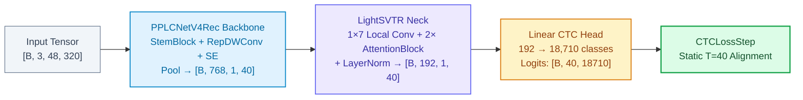

# Scaling Clinical Handwriting OCR in PyTorch: From CPU and Apple Silicon MPS to TorchTPU

**Author:** Muhammad Ghifary  
**Date:** November 21, 2026  
**Series:** Part II — Continuation of [*Building Efficient OCR for Clinical Handwriting with JAX*](https://ghif.github.io/posts/2026-11-12-building-efficient-ocr-clinical-handwriting-jax/)  
**System:** `ocrtorch` (`PP_OCRv6MediumRec`)  
**Dataset:** RxHandBD (Handwritten Prescription Line Crops)

---

The previous [article](https://ghif.github.io/posts/2026-11-12-building-efficient-ocr-clinical-handwriting-jax/) demonstrated how Baidu's PP-OCRv6 text recognizer can be ported from PaddlePaddle to JAX/Flax NNX and fine-tuned on handwritten clinical prescriptions. Three practical constraints motivated that setup: Protected Health Information (PHI) rules that keep patient data off external cloud APIs, tight on-edge and on-premises compute limits, and the risk of Vision-Language Models (VLMs) hallucinating medication names. A compact, locally run Connectionist Temporal Classification (CTC) recognizer addresses all three.

JAX was a great fit for TPU and GPU experiments, but most ML engineers day-to-day live in PyTorch—and often prototype on a MacBook before touching cloud hardware. Moving the workflow to PyTorch raised three practical questions:

1. **Can we port the model cleanly?** Can `ocrtorch` reproduce **100% token-level numerical parity** with `PP-OCRv6_medium_rec` in plain PyTorch without relying on PaddlePaddle at runtime?
2. **Can we train locally on Apple Silicon?** How slow is CPU training on a Mac, how much faster is Apple's Metal Performance Shaders (MPS) backend, and how do we work around missing MPS operators like `aten::_ctc_loss`?
3. **Can the same PyTorch loop scale to Cloud TPUs?** With **TorchTPU** (`torch_tpu`), can the exact same model and training script run on Google Cloud TPU v6e (`tpuv6e`) via the Colab CLI—without rewriting everything in JAX or legacy `torch_xla`?

The short answer to all three is yes. On an Apple M4 Pro, MPS cuts training-step latency by **102.6×** over CPU (from 12.9 seconds down to 125.8 ms per batch of 8) and finishes 12 epochs of RxHandBD fine-tuning in **18 minutes**, dropping validation Character Error Rate (CER) from **21.20%** (Epoch 1) to **13.63%** and lifting Normalized Exact Match from **39.76%** to **56.50%**. And the exact same static-shape PyTorch code runs live on a Google Cloud TPU (`v5e1`) via `ocrtorch-colab` and `torch-tpu 0.3.0`, completing 10 epochs in **325.2 seconds (~5.42 minutes)**—roughly **3.1× faster per steady-state epoch** than MPS—dropping validation CER from the **30.66%** zero-shot baseline to **14.24%** and lifting Normalized Exact Match from **29.75%** to **55.01%**.

Here is how `ocrtorch` works under the hood, what broke along the way, and what the benchmarks show.

---

## Inside PP-OCRv6: How a 34.5M-Parameter Model Reads Handwriting

`PP_OCRv6MediumRec` (~34.5M parameters) takes a fixed-size cropped line image of shape $[B, 3, 48, 320]$ (batch size $B$, 3 color channels, 48 px tall, 320 px wide) and turns it into a sequence of character predictions across 40 time steps. It does this in three stages, shown in Figure 1: a visual backbone (`PPLCNetV4Rec`), a sequence neck (`LightSVTR`), and a linear classification head (`nn.Linear`).


*Figure 1: End-to-end architecture and tensor shape progression of `PP_OCRv6MediumRec`.*

Four design choices keep the model fast without blurring cramped handwriting:

1. **Squash height, keep width (`PPLCNetV4Rec`):**  
   Early layers (`StemBlock`, `blocks2`, `blocks3`) downsample both height and width ($48 \times 320 \to 12 \times 80$). After that, `blocks4` and `blocks5` only stride vertically using `(2, 1)` strides ($12 \times 80 \to 6 \times 80 \to 3 \times 80$). Keeping the horizontal axis wide prevents neighboring handwritten letters from smearing together before sequence modeling. A final pooling step (`avg_pool_valid(x, 3, 2)` in eval; `F.adaptive_avg_pool2d(x, (1, 40))` in training) collapses height to 1 and produces a 40-step feature sequence of shape $[B, 768, 1, 40]$.

2. **Lightweight depthwise blocks (`RepDWConv` and `SqueezeExcite`):**  
   Instead of heavy dense $3 \times 3$ convolutions, `LCNetV4Block` uses `RepDWConv`—summing a $3 \times 3$ depthwise `ConvBN`, a $1 \times 1$ depthwise convolution, and an identity skip connection before `identity_bn`—followed by `SqueezeExcite` channel attention (hard-sigmoid $\text{clamp}((x + 3)/6, 0, 1)$) and a $1 \times 1$ `GELU` MLP.

3. **Cheap global context over 40 steps (`LightSVTR`):**  
   Rather than running a BiLSTM or a full Vision Transformer, `LightSVTR` projects channels down from $768 \to 192$, applies a $1 \times 7$ depthwise `ConvBNActSwish` (`SiLU`) to capture local stroke continuity, and runs just **two `AttentionBlock` layers** (8 heads, `head_dim=24`, `mlp_ratio=4.0`) with a `skip_conv` residual. Because the sequence length is only $T = 40$, self-attention computes $40^2 = 1{,}600$ weights per head—practically free compared to image-level attention.

4. **A wide vocabulary head (`nn.Linear`):**  
   A single `nn.Linear(192, 18710)` layer maps each of the 40 time steps to logits over `18,709` characters (including space) plus the CTC blank token (ID `0`). That single matrix ($192 \times 18{,}710 \approx 3.59\text{M}$ parameters) drives a large share of memory traffic during backpropagation—which is why memory bandwidth makes or breaks training speed across CPU, MPS, and TPU.

---

## Porting Weights Without Silent Drift

Porting a 50+ layer network across frameworks looks straightforward on paper—transpose some arrays and load a `state_dict`. In practice, tiny mismatches in padding or normalization epsilons compound layer by layer until predictions quietly diverge.

### Transposing and mapping the parameter arrays
Converting flattened Paddle/JAX parameter arrays into a PyTorch `state_dict` requires two things: renaming keys (`kernel` → `weight`, `scale` → `weight`, `mean`/`var` → `running_mean`/`running_var`, omitting `num_batches_tracked`) and transposing weight layouts to match PyTorch's channel-first convention:
- **4D Conv Kernels (`HWIO → OIHW`):** Transposed via `np.transpose(val, (3, 2, 0, 1))`.
- **2D Linear Weights (`IO → OI`):** Transposed via `val.T` for attention projections (`qkv`, `proj`), MLP layers (`fc1`, `fc2`), and the `ctc` head.

```python
for k in model.state_dict():
    if k.endswith(".num_batches_tracked"):
        continue
    parts = k.split(".")
    if parts[-1] == "weight":
        suffix = "/scale" if parts[-2] in ("bn", "identity_bn", "norm", "norm1", "norm2") else "/kernel"
        src_key = "/".join(parts[:-1]) + suffix
    elif parts[-1] == "running_mean":
        src_key = "/".join(parts[:-1]) + "/mean"
    elif parts[-1] == "running_var":
        src_key = "/".join(parts[:-1]) + "/var"
    else:
        src_key = "/".join(parts[:-1]) + f"/{parts[-1]}"

    val = data[src_key]
    if val.ndim == 4:      # HWIO -> OIHW
        val = np.transpose(val, (3, 2, 0, 1))
    elif val.ndim == 2:    # IO -> OI
        val = val.T
    mapped[k] = torch.from_numpy(val)
```

### Four subtle details that had to match
To eliminate activation drift across 50+ layers, we matched four framework quirks explicitly:

1. **Asymmetric even-kernel `"same"` padding:** `StemBlock` (`stem2a`, `stem2b`, and max-pooling) uses $2 \times 2$ kernels with right/bottom padding. PyTorch's `nn.Conv2d` does not replicate Paddle's `SAME` padding for even kernels, so `ConvBN` pads the right and bottom edges explicitly before running a zero-padded convolution (and uses $-\infty$ padding before `F.max_pool2d`):

```python
if self.use_custom_even_padding:
    x = F.pad(x, (0, 1, 0, 1))
x = self.conv(x)
x = self.bn(x)
```

2. **Valid-window average pooling (`avg_pool_valid`):** During evaluation, `PPLCNetV4Rec` slices the feature map to exact valid windows and averages across `(kh=3, kw=2)` instead of using standard `AvgPool2d` boundary padding:

```python
def avg_pool_valid(x: torch.Tensor, kh: int = 3, kw: int = 2) -> torch.Tensor:
    b, c, h, w = x.shape
    oh, ow = (h - kh) // kh + 1, (w - kw) // kw + 1
    x = x[:, :, :oh * kh, :ow * kw].reshape(b, c, oh, kh, ow, kw)
    return x.mean(dim=(3, 5))
```

3. **Mixed normalization epsilons:** `BatchNorm2d` and `AttentionBlock` `LayerNorm` layers use `eps=1e-5`, whereas `LightSVTR`'s output `LayerNorm` uses `eps=1e-6`.
4. **BGR input preprocessing:** Image preprocessing matches PaddleOCR's `DecodeImage` BGR channel order (`rgb[:, :, ::-1]`), scales height to 48 px while preserving aspect ratio (clamped at 320 px), zero-pads on the right, and normalizes pixels to `[-1, 1]`.

### Parity check
Evaluating intermediate outputs of `PP_OCRv6MediumRec` against reference activations from the original model confirms that all 16 intermediate stages stay within float32 tolerance ($\max |\Delta| < 2 \times 10^{-4}$), with **40 / 40 (100.00%) greedy argmax token agreement** (Table 1).

| Stage | Output Shape | Max Absolute Diff | Mean Absolute Diff |
| :--- | :---: | :---: | :---: |
| `backbone_stem` | `[1, 128, 12, 80]` | $4.00 \times 10^{-5}$ | $8.89 \times 10^{-7}$ |
| `backbone_blocks5` | `[1, 768, 3, 80]` | $5.26 \times 10^{-5}$ | $2.14 \times 10^{-6}$ |
| `backbone_pool` | `[1, 768, 1, 40]` | $2.71 \times 10^{-5}$ | $1.69 \times 10^{-6}$ |
| `neck_block_1` | `[1, 40, 192]` | $1.95 \times 10^{-5}$ | $3.42 \times 10^{-6}$ |
| `ctc_logits` | `[1, 40, 18710]` | $8.42 \times 10^{-5}$ | $6.49 \times 10^{-6}$ |
| `probabilities` | `[1, 40, 18710]` | $2.90 \times 10^{-5}$ | $1.08 \times 10^{-9}$ |
| **Argmax Token Agreement** | **40 / 40 steps** | — | **100.00%** |

*Table 1: Numerical parity verification across key stages of `PP_OCRv6MediumRec` against reference activations.*

---

## Fine-Tuning Without Character Bounding Boxes (CTC)

In RxHandBD, we have cropped images of handwritten prescription words and their ground-truth text transcripts—but no bounding boxes telling us which horizontal slice corresponds to which letter.

That is what **Connectionist Temporal Classification (CTC)** solves. Given an image $X$ and a transcript $y = (y_1, \dots, y_L)$ of length $L \le T$, the model outputs logits $Z \in \mathbb{R}^{T \times V}$ across $T = 40$ time steps and $V = 18{,}710$ tokens. Taking a softmax at each step gives frame-level probabilities $p_t(k \mid X)$.

CTC adds a special **blank** symbol $\epsilon$ (ID `0`) and defines a collapsing rule $\mathcal{B}$ that merges repeated consecutive tokens and drops all $\epsilon$ tokens (so `"aa_bb"` and `"a_b_b"` both collapse to `"ab"`). Because we do not know the exact alignment, CTC sums the probability of *every* valid 40-step path $\pi \in \mathcal{B}^{-1}(y)$ that collapses to the target word:

$$P(y \mid X) = \sum_{\pi \in \mathcal{B}^{-1}(y)} \prod_{t=1}^{T} p_t(\pi_t \mid X)$$

`CTCLossStep` minimizes the negative log-likelihood via dynamic programming:

$$\mathcal{L}_{\text{CTC}}(X, y) = -\log P(y \mid X)$$

configured with `blank=0`, `zero_infinity=True`, and `reduction="mean"`. At inference and validation time, greedy CTC decoding simply takes the top token at each step ($\arg\max_k Z_{t,k}$) and applies $\mathcal{B}$.

### Keeping shapes static for XLA and TorchTPU
Dynamic image widths cause constant graph recompilation on TPUs. To keep the pipeline compatible with XLA/TorchTPU, batch collation pads every batch to fixed `[B, 3, 48, 320]` inputs with static `input_lengths = 40`, while zero-padding `targets` to the longest transcript in the batch alongside `target_lengths`. During training, mild brightness and contrast jitter in $[0.9, 1.1]$ simulates scan and lighting variation.

### Training recipe
Training uses `AdamW` ($\text{lr} = 1 \times 10^{-5}$, weight decay $1 \times 10^{-4}$), skips any batch with `NaN` or `Inf` loss, and clips global gradient norms at `max_grad_norm = 5.0`. After each epoch, it evaluates validation Character Error Rate (CER—lower is better) and Normalized Exact Match (percentage of words transcribed completely right). Early stopping (`patience=3`, `min_delta=1e-4`) saves the best checkpoint whenever CER improves and stops training after 3 epochs without improvement.

---

## Meet TorchTPU: Native PyTorch on Google Cloud TPUs

Before looking at how `ocrtorch` runs across backends, it helps to understand why **TorchTPU** (`torch_tpu`) changes the PyTorch-on-TPU story.

Historically, running PyTorch on Google Cloud TPUs meant adopting `torch_xla`: a lazy-tensor wrapper that required `xm.xla_device()`, explicit `xm.mark_step()` graph barriers, and careful refactoring to avoid silent CPU fallbacks. For teams prototyping locally on a MacBook or GPU workstation, maintaining both standard PyTorch and `torch_xla` code paths added real friction.

Announced in late 2026 as an open-source collaboration between Google and Meta, **TorchTPU** replaces that wrapper model with a **native PyTorch backend**. Rather than intercepting tensors through a separate lazy-execution layer, `torch_tpu` plugs directly into the **PyTorch dispatcher**, giving TPUs first-class device status (`torch.device("tpu")`) alongside `"cpu"`, `"cuda"`, and `"mps"`:

- **Eager by default, compiled when needed:** You can run and debug standard PyTorch eager code directly on a TPU, then opt into `torch.compile()` backed by custom ATen kernels, StableHLO, and XLA compilation caches.
- **Minimal code changes:** Swapping a training loop from CPU or Apple Silicon MPS to a Cloud TPU is a device-string change rather than a framework rewrite:

```python
import torch_tpu  # Registers the "tpu" backend with PyTorch

device = torch.device("tpu")
```

Figure 2 contrasts the legacy `torch_xla` wrapper path with TorchTPU's native dispatcher integration and shows how `ocrtorch` targets CPU, MPS, and TPU from the same training loop.


*Figure 2: Legacy `torch_xla` lazy-tensor workflow versus TorchTPU's native PyTorch dispatcher integration alongside CPU and Apple Silicon MPS.*

---

## From Laptop CPU to Apple Silicon MPS and Cloud TorchTPU

One codebase (`ocrtorch`) targets three hardware backends:

### 1. CPU baseline (`--device cpu`)
Good for verifying correctness, but backpropagating through 16 depthwise separable convolution stages and the $192 \times 18{,}710$ linear head quickly saturates CPU memory bandwidth.

### 2. Apple Silicon MPS (`--device mps`) + a tiny CPU bridge
Running on the Apple Silicon GPU via `--device mps` speeds up all the convolutions and attention layers—until you hit the loss function. PyTorch 2.10.0 does not yet implement `aten::_ctc_loss` on MPS.

Rather than falling back to CPU for the whole model, `CTCLossStep` uses a small CPU bridge: when `logits.device.type == "mps"`, it copies just `log_probs`, `targets`, `input_lengths`, and `target_lengths` to CPU for `nn.CTCLoss`, then moves the scalar loss back to `mps`. PyTorch autograd still propagates gradients back through the MPS computation graph.

### 3. Cloud TPU via TorchTPU (`--device tpu`)
When moving from a laptop to a Google Cloud TPU, `ocrtorch` uses **TorchTPU** (`torch_tpu`) directly—no legacy `torch_xla` boilerplate like `xm.xla_device()` or `xm.mark_step()`:
- **Native device selection:** Resolving the TPU device simply imports `torch_tpu` and returns `torch.device("tpu")`, so the trainer runs standard PyTorch forward, backward, and `optimizer.step()` calls.
- **Automated Colab CLI runner (`ocrtorch-colab`):** The cloud launcher maps `--tpu tpuv6e` to Colab CLI's `--tpu v6e1` (and also supports `--tpu v5e1` via `colab new -s <session> --tpu <variant>`) and runs a four-step lifecycle:
  1. `prepare`: Installs `torch-tpu` and dependencies, checks `torch.device("tpu")` with a live tensor, and unpacks the training package and manifests.
  2. `stage`: Uses a short-lived Google ADC OAuth token to pull the model weights, configuration, and RxHandBD images from Google Cloud Storage, rewriting manifest paths locally.
  3. `train`: Strips cloud storage tokens from the remote config and runs training with `--device tpu`.
  4. `upload`: Mints a fresh ADC token to upload the best/latest checkpoints and training summary back to cloud storage, followed by `colab stop` cleanup.

---

## Benchmarks and RxHandBD Fine-Tuning Results

All local experiments ran on an **Apple M4 Pro** (12 CPU cores, MPS GPU, 24 GB Unified Memory, macOS, Python 3.13.15 / 3.11.11, PyTorch 2.10.0). The **RxHandBD** training split (seed `20261017`, without touching held-out test labels) is divided into **3,794 training crops** (85%) and **669 validation crops** (15%), trained with `batch_size=8` and max `epochs=20`.

### CPU vs. Apple Silicon MPS speedups
We benchmarked float32 inference and training steps using `[B, 3, 48, 320]` tensors with explicit `torch.mps.synchronize()` calls (Table 2).

| Workload | Batch Size | CPU (12 Cores) | Apple Silicon MPS | Speedup (MPS / CPU) |
| :--- | :---: | :---: | :---: | :---: |
| **Inference** | 1 | 2,526.37 ms (`0.40 img/s`) | **8.91 ms** (`112.21 img/s`) | **283.5×** |
| **Inference** | 8 | 3,778.85 ms (`2.12 img/s`) | **47.76 ms** (`167.50 img/s`) | **79.1×** |
| **Inference** | 16 | 3,641.86 ms (`4.39 img/s`) | **98.17 ms** (`162.98 img/s`) | **37.1×** |
| **Training Step** | 8 | 12,911.58 ms (`0.62 img/s`) | **125.80 ms** (`63.59 img/s`) | **102.6×** |
| **Training Step** | 16 | 21,873.26 ms (`0.73 img/s`) | **276.54 ms** (`57.86 img/s`) | **79.1×** |

*Table 2: Inference and training-step latency and throughput comparison on Apple M4 Pro.*

To put those numbers in perspective: at batch size 8, a 475-step epoch on RxHandBD would take **~102.2 minutes (~1.7 hours)** on CPU—or roughly **34.1 hours** for 20 epochs. On MPS, 475 training steps take **~59.8 seconds**.

### Fine-tuning on MPS
Fine-tuning on Apple Silicon MPS completed **12 epochs in 1,082.35 seconds (~18.04 minutes)** before early stopping triggered. Table 3 shows the full training curve.

| Epoch | Train Loss | Val Loss | Val CER | Norm Exact Match | Time (s) | Checkpoint Status |
| :---: | :---: | :---: | :---: | :---: | :---: | :--- |
| 1 | 1.1210 | 0.8586 | 21.20% | 39.76% | 65.8 | Best |
| 2 | 0.8100 | 0.7523 | 19.09% | 46.04% | 103.4 | Best |
| 3 | 0.6755 | 0.6664 | 16.37% | 52.62% | 101.1 | Best |
| 4 | 0.5665 | 0.7559 | 17.60% | 43.65% | 89.8 | Patience 1/3 |
| 5 | 0.4833 | **0.6648** | 15.23% | 53.06% | 90.8 | Best |
| 6 | 0.4106 | 0.6751 | 14.92% | 52.91% | 88.4 | Best |
| 7 | 0.3385 | 0.7218 | 14.83% | 52.47% | 89.0 | Best |
| 8 | 0.2912 | 0.6899 | 14.11% | 55.01% | 87.5 | Best |
| **9** | **0.2520** | 0.7269 | **13.63%** | **56.50%** | 79.9 | **Best (Selected)** |
| 10 | 0.2137 | 0.7704 | 14.22% | 56.05% | 86.4 | Patience 1/3 |
| 11 | 0.1738 | 0.7926 | 14.29% | 55.16% | 87.0 | Patience 2/3 |
| 12 | 0.1521 | 0.8209 | 13.67% | 55.75% | 85.7 | Early Stop (3/3) |

*Table 3: Validation and training metrics across 12 epochs of RxHandBD fine-tuning on Apple Silicon MPS.*

### Fine-tuning on Google Cloud TPU (`v5e1` via TorchTPU)
The Colab CLI orchestration passes **27 automated unit and integration tests** (`torch_tpu` device resolution, variant mapping, session cleanup, and cloud storage staging/upload). For the live cloud run, `v6e1` hit a 120-second HTTP read timeout twice during Colab session creation, while `v5e1` provisioned immediately (`./scripts/finetune-colab-tpu.sh --tpu v5e1`) with **Python 3.13**, **PyTorch 2.15.0**, **TorchTPU 0.3.0**, and **libtpu 0.0.50**.

Before Epoch 1, the zero-shot pretrained `PP-OCRv6_medium_rec` baseline scored **2.0558** validation loss, **30.66%** CER, and **29.75%** Normalized Exact Match on the 669 validation crops. Fine-tuning on `v5e1` completed **10 epochs in 325.2 seconds (~5.42 minutes)** before early stopping triggered at Epoch 10 (Table 4).

| Epoch | Train Loss | Val Loss | Val CER | Norm Exact Match | Time (s) | Checkpoint Status |
| :---: | :---: | :---: | :---: | :---: | :---: | :--- |
| 1 | 1.1135 | 0.8456 | 21.29% | 42.75% | 46.3 | Best *(includes XLA compile)* |
| 2 | 0.8157 | 0.7752 | 18.28% | 47.68% | 27.5 | Best |
| 3 | 0.6663 | 0.7232 | 16.61% | 49.78% | 30.1 | Best |
| 4 | 0.5575 | 0.6700 | 15.87% | 51.42% | 30.1 | Best |
| 5 | 0.4680 | 0.6677 | 14.75% | 54.26% | 28.3 | Best |
| 6 | 0.4029 | **0.6625** | 14.53% | 54.71% | 28.0 | Best |
| **7** | **0.3324** | 0.6776 | **14.24%** | **55.01%** | 29.1 | **Best (Selected)** |
| 8 | 0.2742 | 0.7137 | 14.48% | 54.41% | 29.1 | Patience 1/3 |
| 9 | 0.2373 | 0.7723 | 14.33% | 55.16% | 28.5 | Patience 2/3 |
| 10 | 0.1973 | 0.7471 | 14.51% | 54.26% | 29.5 | Early Stop (3/3) |

*Table 4: Validation and training metrics across 10 epochs of RxHandBD fine-tuning on Google Cloud TPU `v5e1` via TorchTPU.*

Three operational details stood out from the live TPU run:
- **Graph compilation and cache efficiency:** Epoch 1 took `46.3s` due to initial StableHLO/XLA compilation, after which Epochs 2–10 stabilized at an average of **`28.9s` per epoch** (`27.5s`–`30.1s`). The XLA compilation cache logged **3,194,936** cache requests with **3,194,205 hits (99.9%)**, **731** compilations, and **0** unbounded dynamic hits—confirming that fixed `[B, 3, 48, 320]` tensor shapes prevented recompilation thrashing.
- **Artifact upload:** The best checkpoint (Epoch 7) and training summary (3 files) were uploaded automatically to `gs://handnotes-ocr/model-dir/finetuned-runs/ppocrv6-rxhandbd-20261121T074723702215Z`, and the Colab session was stopped cleanly.

### Cross-backend summary
Table 5 summarizes the end-to-end fine-tuning results across all three backends (`batch_size=8`, `lr=1e-5`, `patience=3`).

| Backend | Hardware / Runtime | Steady-State Epoch Time | Total Run Time | Best Val CER | Best Norm Exact Match |
| :--- | :--- | :---: | :---: | :---: | :---: |
| **CPU** | Apple M4 Pro (12 cores) | ~102.2 min *(projected)* | ~17–34 hrs *(projected)* | — | — |
| **MPS** | Apple M4 Pro GPU (`PyTorch 2.10.0`) | ~88.5 s *(Epochs 2–12 avg)* | 1,082.35 s (18.04 min, 12 ep) | **13.63%** *(Ep 9)* | **56.50%** *(Ep 9)* |
| **TorchTPU** | Colab TPU `v5e1` (`torch-tpu 0.3.0`) | **~28.9 s** *(Epochs 2–10 avg)* | **325.2 s (5.42 min, 10 ep)** | **14.24%** *(Ep 7)* | **55.01%** *(Ep 7)* |

*Table 5: Cross-backend training speed and validation accuracy comparison on RxHandBD (`batch_size=8`).*

---

## What Worked, and What Remains

1. **Early stopping matters on 3,794 crops:** On both MPS and TPU `v5e1`, validation CER improved rapidly from the **30.66%** zero-shot baseline down to **13.63%–14.24%** (+25–27 percentage points in Normalized Exact Match), before `train_loss` kept falling while `val_loss` climbed and CER plateaued. Setting `patience=3` on validation CER reliably selected the best checkpoint (Epoch 9 on MPS; Epoch 7 on TPU) without overfitting.
2. **The CPU fallback bridge unblocked Apple Silicon training:** Moving `[40, 8, 18710]` CTC loss inputs to CPU avoids the missing `aten::_ctc_loss` MPS kernel while keeping training **102.6× faster than CPU** at batch size 8. Native MPS CTC lowering would still be cleaner by eliminating host-device synchronization altogether.
3. **TorchTPU delivers ~3.1× faster epochs with zero code changes:** Running the exact same training loop on Colab `v5e1` via `torch.device("tpu")` cut steady-state epoch time from **~88.5s** (MPS) to **~28.9s**, with a **99.9%** XLA compilation cache hit rate. Next steps are benchmarking `v6e1` when Colab capacity is available, testing larger TPU batch sizes (`32`/`64`) with `torch.compile()` and `libtcmalloc` preloaded, and running a final evaluation of the selected checkpoints on the held-out RxHandBD test split.

---

## References

1. Ghifary, M. (2026). *Building Efficient OCR for Clinical Handwriting with JAX*. https://ghif.github.io/posts/2026-11-12-building-efficient-ocr-clinical-handwriting-jax/
2. PaddleOCR Team. *PP-OCRv6: Practical Ultra-Lightweight OCR System*. arXiv:2606.13108.
3. Graves, A., Fernández, S., Gomez, F., & Schmidhuber, J. (2006). *Connectionist Temporal Classification: Labelling Unsegmented Sequence Data with Recurrent Neural Networks*. ICML.
4. PyTorch & Google Cloud. *Introducing TorchTPU: Native PyTorch Backend for Google Cloud TPUs*. https://pytorch.org/blog/introducing-torchtpu/
5. RxHandBD: *A Handwritten Prescription Word Image Dataset*. Mendeley Data, DOI: 10.17632/dsb5r6vskg.3.
