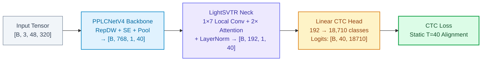

# Scaling Clinical Handwriting OCR in PyTorch: From CPU and Apple Silicon MPS to TorchTPU

**Author:** Muhammad Ghifary  
**Date:** November 21, 2026  
**Series:** Part II — Continuation of [*Building Efficient OCR for Clinical Handwriting with JAX*](https://ghif.github.io/posts/2026-11-12-building-efficient-ocr-clinical-handwriting-jax/)  
**Model:** PP-OCRv6 Medium Recognizer (`PP-OCRv6_medium_rec`)  
**Dataset:** RxHandBD (Handwritten Prescription Line Crops)

---

The previous [article](https://ghif.github.io/posts/2026-11-12-building-efficient-ocr-clinical-handwriting-jax/) demonstrated how Baidu's PP-OCRv6 text recognizer can be ported from PaddlePaddle to JAX/Flax NNX and fine-tuned on handwritten clinical prescriptions. Three practical constraints motivated that setup: Protected Health Information (PHI) rules that keep patient data off external cloud APIs, tight on-edge and on-premises compute limits, and the risk of Vision-Language Models (VLMs) hallucinating medication names. A compact, locally run Connectionist Temporal Classification (CTC) recognizer addresses all three.

JAX was a great fit for TPU and GPU experiments, but most ML engineers day-to-day live in PyTorch—and often prototype on a MacBook before touching cloud hardware. Moving the workflow to PyTorch raised three practical questions:

1. **Can we port the model cleanly?** Can a pure PyTorch implementation reproduce **100% token-level numerical parity** with `PP-OCRv6_medium_rec` without relying on PaddlePaddle at runtime?
2. **Can we train locally on Apple Silicon?** How slow is CPU training on a Mac, how much faster is Apple's Metal Performance Shaders (MPS) backend, and how do we work around missing MPS operators like `aten::_ctc_loss`?
3. **Can the same PyTorch loop scale to Cloud TPUs?** With **TorchTPU** (`torch_tpu`), can the exact same model and training loop run on Google Cloud TPUs via the Colab CLI—without rewriting everything in JAX or legacy `torch_xla`?

The short answer to all three is yes. On an Apple M4 Pro, MPS cuts training-step latency by **102.6×** over CPU (from 12.9 seconds down to 125.8 ms per batch of 8) and finishes 12 epochs of RxHandBD fine-tuning in **18 minutes**, dropping validation Character Error Rate (CER) from **21.20%** (Epoch 1) to **13.63%** and lifting Normalized Exact Match from **39.76%** to **56.50%**. And the exact same static-shape PyTorch code runs live on a Google Cloud TPU (`v5e1`) via `torch-tpu 0.3.0`, completing 10 epochs in **325.2 seconds (~5.42 minutes)**—roughly **3.1× faster per steady-state epoch** than MPS—dropping validation CER from the **30.66%** zero-shot baseline to **14.24%** and lifting Normalized Exact Match from **29.75%** to **55.01%**.

Here is how the PyTorch and TorchTPU stack fits together, how the model was ported without numerical drift, and what the benchmarks show.

---

## PyTorch and TorchTPU: One Codebase from Laptop to Cloud

PyTorch's appeal for applied ML work is its unified execution model: you write standard Pythonic tensor code, debug interactively in eager mode, and target CPUs, NVIDIA GPUs, or Apple Silicon GPUs (via Metal Performance Shaders, **MPS**) by changing a device string.

Until recently, Google Cloud TPUs were the awkward exception. Running PyTorch on TPUs meant adopting `torch_xla`: a lazy-tensor wrapper that required `xm.xla_device()`, explicit `xm.mark_step()` graph barriers, and careful refactoring to avoid silent CPU fallbacks. Maintaining both standard PyTorch for a MacBook and `torch_xla` for Cloud TPUs added real friction.

Announced in late 2026 as an open-source collaboration between Google and Meta, **TorchTPU** (`torch_tpu`) replaces that wrapper model with a **native PyTorch backend**. Rather than intercepting tensors through a separate lazy-execution layer, `torch_tpu` plugs directly into the **PyTorch dispatcher**, giving TPUs first-class device status (`torch.device("tpu")`) alongside `"cpu"`, `"cuda"`, and `"mps"`:

- **Eager by default, compiled when needed:** You can run and debug standard PyTorch eager code directly on a TPU, then opt into `torch.compile()` backed by custom ATen kernels, StableHLO, and XLA compilation caches.
- **Minimal code changes:** Moving a training loop from a laptop CPU or Apple Silicon MPS to a Cloud TPU is a device-string change rather than a framework rewrite:

```python
import torch_tpu  # Registers the "tpu" backend with PyTorch

device = torch.device("tpu")
```

Figure 1 contrasts the legacy `torch_xla` wrapper path with TorchTPU's native dispatcher integration, showing how one PyTorch training loop targets CPU, MPS, and Cloud TPU.


*Figure 1: Legacy `torch_xla` lazy-tensor workflow versus TorchTPU's native PyTorch dispatcher integration alongside CPU and Apple Silicon MPS.*

---

## Inside PP-OCRv6: How a 34.5M-Parameter Model Reads Handwriting

With the execution stack settled, we need a recognizer small enough for local hardware yet accurate on cramped prescription handwriting. The PP-OCRv6 medium recognizer (~34.5M parameters) takes a fixed-size cropped line image of shape $[B, 3, 48, 320]$ (batch size $B$, 3 color channels, 48 px tall, 320 px wide) and turns it into a sequence of character predictions across 40 time steps. It does this in three stages, shown in Figure 2: a visual backbone (`PPLCNetV4`), a sequence neck (`LightSVTR`), and a linear classification head (`nn.Linear`).


*Figure 2: End-to-end architecture and tensor shape progression of the PP-OCRv6 medium recognizer.*

Four design choices keep the model fast without blurring cramped handwriting:

1. **Squash height, keep width (`PPLCNetV4`):**  
   The stem and early stages downsample both height and width ($48 \times 320 \to 12 \times 80$). Deeper stages only stride vertically using `(2, 1)` strides ($12 \times 80 \to 6 \times 80 \to 3 \times 80$). Keeping the horizontal axis wide prevents neighboring handwritten letters from smearing together before sequence modeling. A final pooling step (valid-window averaging over $3 \times 2$ in eval; `F.adaptive_avg_pool2d(x, (1, 40))` in training) collapses height to 1 and produces a 40-step feature sequence of shape $[B, 768, 1, 40]$.

2. **Lightweight depthwise blocks (`RepDW` and `SqueezeExcite`):**  
   Instead of heavy dense $3 \times 3$ convolutions, each residual block uses reparameterizable depthwise convolutions—summing a $3 \times 3$ depthwise conv-BN branch, a $1 \times 1$ depthwise convolution, and an identity skip connection with batch normalization—followed by `SqueezeExcite` channel attention (hard-sigmoid $\text{clamp}((x + 3)/6, 0, 1)$) and a $1 \times 1$ `GELU` MLP.

3. **Cheap global context over 40 steps (`LightSVTR`):**  
   Rather than running a BiLSTM or a full Vision Transformer, `LightSVTR` projects channels down from $768 \to 192$, applies a $1 \times 7$ depthwise `SiLU` convolution to capture local stroke continuity, and runs just **two multi-head self-attention blocks** (8 heads, head dimension 24, MLP ratio 4.0) with a residual projection. Because the sequence length is only $T = 40$, self-attention computes $40^2 = 1{,}600$ weights per head—practically free compared to image-level attention.

4. **A wide vocabulary head (`nn.Linear`):**  
   A single `nn.Linear(192, 18710)` layer maps each of the 40 time steps to logits over `18,709` characters (including space) plus the CTC blank token (ID `0`). That single matrix ($192 \times 18{,}710 \approx 3.59\text{M}$ parameters) drives a large share of memory traffic during backpropagation—which is why memory bandwidth makes or breaks training speed across CPU, MPS, and TPU.

---

## Porting Weights Without Silent Drift

Porting a 50+ layer network across frameworks looks straightforward on paper—transpose some arrays and load a `state_dict`. In practice, tiny mismatches in padding or normalization epsilons compound layer by layer until predictions quietly diverge.

### Transposing and mapping the parameter arrays
Converting flattened Paddle/JAX parameter arrays into a PyTorch `state_dict` requires two things: renaming keys (`kernel` → `weight`, `scale` → `weight`, `mean`/`var` → `running_mean`/`running_var`, omitting `num_batches_tracked`) and transposing weight layouts to match PyTorch's channel-first convention:
- **4D Conv Kernels (`HWIO → OIHW`):** Transposed via `np.transpose(val, (3, 2, 0, 1))`.
- **2D Linear Weights (`IO → OI`):** Transposed via `val.T` for attention projections (`qkv`, `proj`), MLP layers (`fc1`, `fc2`), and the `ctc` head.

```python
for k in model.state_dict():
    if k.endswith(".num_batches_tracked"):
        continue
    parts = k.split(".")
    if parts[-1] == "weight":
        suffix = "/scale" if parts[-2] in ("bn", "identity_bn", "norm", "norm1", "norm2") else "/kernel"
        src_key = "/".join(parts[:-1]) + suffix
    elif parts[-1] == "running_mean":
        src_key = "/".join(parts[:-1]) + "/mean"
    elif parts[-1] == "running_var":
        src_key = "/".join(parts[:-1]) + "/var"
    else:
        src_key = "/".join(parts[:-1]) + f"/{parts[-1]}"

    val = data[src_key]
    if val.ndim == 4:      # HWIO -> OIHW
        val = np.transpose(val, (3, 2, 0, 1))
    elif val.ndim == 2:    # IO -> OI
        val = val.T
    mapped[k] = torch.from_numpy(val)
```

### Four subtle details that had to match
To eliminate activation drift across 50+ layers, we matched four framework quirks explicitly:

1. **Asymmetric even-kernel `"same"` padding:** The stem's $2 \times 2$ convolutions and max-pooling layers use right/bottom padding. PyTorch's `nn.Conv2d` does not replicate Paddle's `SAME` padding for even kernels, so those layers apply `F.pad(x, (0, 1, 0, 1))` explicitly before running a zero-padded convolution (and $-\infty$ padding before `F.max_pool2d`):

```python
if self.use_custom_even_padding:
    x = F.pad(x, (0, 1, 0, 1))
x = self.conv(x)
x = self.bn(x)
```

2. **Valid-window average pooling:** During evaluation, the final backbone pooling slices the feature map to exact valid windows and averages across `(kh=3, kw=2)` instead of using standard `AvgPool2d` boundary padding:

```python
def avg_pool_valid(x: torch.Tensor, kh: int = 3, kw: int = 2) -> torch.Tensor:
    b, c, h, w = x.shape
    oh, ow = (h - kh) // kh + 1, (w - kw) // kw + 1
    x = x[:, :, :oh * kh, :ow * kw].reshape(b, c, oh, kh, ow, kw)
    return x.mean(dim=(3, 5))
```

3. **Mixed normalization epsilons:** `BatchNorm2d` and the `LightSVTR` attention `LayerNorm` layers use `eps=1e-5`, whereas `LightSVTR`'s final output `LayerNorm` uses `eps=1e-6`.
4. **BGR input preprocessing:** Image preprocessing matches PaddleOCR's BGR channel order (`rgb[:, :, ::-1]`), scales height to 48 px while preserving aspect ratio (clamped at 320 px), zero-pads on the right, and normalizes pixels to `[-1, 1]`.

### Parity check
Evaluating intermediate outputs of the PyTorch model against reference activations from the original model confirms that all 16 intermediate stages stay within float32 tolerance ($\max |\Delta| < 2 \times 10^{-4}$), with **40 / 40 (100.00%) greedy argmax token agreement** (Table 1).

| Stage | Output Shape | Max Absolute Diff | Mean Absolute Diff |
| :--- | :---: | :---: | :---: |
| `backbone_stem` | `[1, 128, 12, 80]` | $4.00 \times 10^{-5}$ | $8.89 \times 10^{-7}$ |
| `backbone_blocks5` | `[1, 768, 3, 80]` | $5.26 \times 10^{-5}$ | $2.14 \times 10^{-6}$ |
| `backbone_pool` | `[1, 768, 1, 40]` | $2.71 \times 10^{-5}$ | $1.69 \times 10^{-6}$ |
| `neck_block_1` | `[1, 40, 192]` | $1.95 \times 10^{-5}$ | $3.42 \times 10^{-6}$ |
| `ctc_logits` | `[1, 40, 18710]` | $8.42 \times 10^{-5}$ | $6.49 \times 10^{-6}$ |
| `probabilities` | `[1, 40, 18710]` | $2.90 \times 10^{-5}$ | $1.08 \times 10^{-9}$ |
| **Argmax Token Agreement** | **40 / 40 steps** | — | **100.00%** |

*Table 1: Numerical parity verification across key stages of the PyTorch PP-OCRv6 port against reference activations.*

---

## Fine-Tuning Mechanism and Algorithm (CTC)

Once the ported PyTorch weights match reference predictions, the next step is fine-tuning on RxHandBD. Like most real-world OCR datasets, RxHandBD gives us cropped images of handwritten prescription words and their ground-truth text transcripts—but no bounding boxes telling us which horizontal slice corresponds to which letter.

### 1. CTC alignment and loss formulation
**Connectionist Temporal Classification (CTC)** solves unsegmented sequence alignment. Given an input image $X$ and a target transcript $y = (y_1, \dots, y_L)$ of length $L \le T$, the network outputs frame-level logits $Z \in \mathbb{R}^{T \times V}$ ($T = 40$, $V = 18{,}710$). Applying log-softmax across the vocabulary axis yields frame-wise log-probabilities:

$$\log p_t(k \mid X) = Z_{t,k} - \log \sum_{j=1}^{V} \exp(Z_{t,j})$$

CTC introduces a special **blank** symbol $\epsilon$ (ID `0`) and a collapsing operator $\mathcal{B}$ that merges repeated consecutive tokens and removes all $\epsilon$ tokens (so `"aa_bb"` and `"a_b_b"` both collapse to `"ab"`). Internally, dynamic programming inserts $\epsilon$ between and around target characters to form an expanded sequence $y' = (\epsilon, y_1, \epsilon, y_2, \dots, y_L, \epsilon)$ of length $2L + 1$ and marginalizes over every valid monotonic alignment path $\pi \in \mathcal{B}^{-1}(y)$ of length $T = 40$:

$$P(y \mid X) = \sum_{\pi \in \mathcal{B}^{-1}(y)} \prod_{t=1}^{T} p_t(\pi_t \mid X), \qquad \mathcal{L}_{\text{CTC}}(X, y) = -\log P(y \mid X)$$

PyTorch's `nn.CTCLoss(blank=0, zero_infinity=True, reduction="mean")` computes this exact forward-backward loss over `[T, B, V]` log-probabilities (`zero_infinity=True` zeros out any invalid path whose loss would otherwise diverge to $+\infty$).

### 2. Which parameters are fine-tuned (and why BatchNorm stays frozen)
A critical stability detail when fine-tuning a ported PP-OCRv6 model on small batches (`batch_size=8`) is **selective parameter freezing**:

- **Frozen (`requires_grad = False`, `.eval()` mode):** All `nn.BatchNorm2d` layers across `PPLCNetV4` and `LightSVTR`—including their affine scale/shift (`weight`, `bias`) and `running_mean`/`running_var` statistics—are kept frozen in evaluation mode throughout training. Updating batch normalization statistics on small, noisy handwriting batches perturbs the pretrained normalization scale and can trigger gradient explosion and CER collapse.
- **Fine-tuned (`requires_grad = True`):** Every remaining layer is updated end-to-end:
  - **Visual backbone (`PPLCNetV4`):** All $3 \times 3$ and $1 \times 1$ depthwise and pointwise convolutional weights/biases and `SqueezeExcite` channel-attention layers.
  - **Sequence neck (`LightSVTR`):** The $1 \times 7$ local depthwise convolution, all projection/MLP weights (`qkv`, `proj`, `fc1`, `fc2`) in both self-attention blocks, and the `LayerNorm` scale/bias parameters.
  - **CTC classification head (`nn.Linear(192, 18710)`):** The full vocabulary projection matrix and bias (~3.59M parameters), which adapts character logit priors to handwritten clinical vocabulary.

```python
def freeze_batchnorm(model: nn.Module) -> None:
    for m in model.modules():
        if isinstance(m, nn.BatchNorm2d):
            m.eval()
            m.weight.requires_grad = False
            m.bias.requires_grad = False

freeze_batchnorm(model)
trainable_params = [p for p in model.parameters() if p.requires_grad]
optimizer = torch.optim.AdamW(trainable_params, lr=1e-5, weight_decay=1e-4)
```

### 3. Static-shape batching and optimization loop
Because TorchTPU compiles static graphs via StableHLO/XLA, dynamic image widths would trigger constant recompilation on TPUs. To avoid that, batch collation pads every batch to fixed `[B, 3, 48, 320]` inputs with static `input_lengths = 40`, while zero-padding `targets` to the longest transcript in the batch alongside `target_lengths`. During training, mild brightness and contrast jitter in $[0.9, 1.1]$ simulates scan and lighting variation.

On each training step, any batch producing a `NaN` or `Inf` loss is skipped. For valid batches, gradients $g_t = \nabla_{\theta_{\text{train}}} \mathcal{L}_{\text{CTC}}$ are globally clipped to norm $\tau = 5.0$ before the `AdamW` update ($\eta = 10^{-5}$, weight decay $\lambda = 10^{-4}$):

$$\tilde{g}_t = g_t \cdot \min\!\left(1, \frac{\tau}{\|g_t\|_2}\right)$$

```python
model.train()
freeze_batchnorm(model)  # Keep BatchNorm running stats locked in eval mode

optimizer.zero_grad()
logits = model(images)                                # [B, 40, 18710]
log_probs = logits.log_softmax(dim=-1).permute(1, 0, 2)  # [40, B, 18710]
loss = criterion(log_probs, targets, input_lengths, target_lengths)

if not (torch.isnan(loss) or torch.isinf(loss)):
    loss.backward()
    torch.nn.utils.clip_grad_norm_(trainable_params, max_norm=5.0)
    optimizer.step()
```

### 4. Validation metrics and early stopping
After each epoch, the model runs greedy CTC decoding—taking $\hat{\pi}_t = \arg\max_k Z_{t,k}$ at each of the 40 steps and applying $\mathcal{B}(\hat{\pi})$. Both reference transcripts $r_i$ and predictions $\hat{y}_i$ are case-folded and whitespace-collapsed ($\tilde{s} = \text{" ".join}(s\text{.casefold().split()})$), and corpus Character Error Rate (CER) is computed via Levenshtein edit distance:

$$\text{CER} = \frac{\sum_{i=1}^{N} d_{\text{edit}}(\tilde{r}_i, \tilde{y}_i)}{\sum_{i=1}^{N} |\tilde{r}_i|}$$

Alongside CER, we track **Normalized Exact Match** (fraction of crops where $\tilde{y}_i = \tilde{r}_i$). Early stopping monitors validation CER with `patience=3` and `min_delta=1e-4`: a checkpoint is saved as the best model only when $\text{CER}_{\text{val}} < \text{CER}_{\text{best}} - 10^{-4}$, and training halts after 3 consecutive epochs without improvement.

---

## Running One Codebase Across CPU, Apple Silicon MPS, and Cloud TPU

With static shapes and `nn.CTCLoss` in place, the same PyTorch training loop runs across all three hardware backends—with one small workaround on Apple Silicon:

### 1. CPU baseline
Good for verifying correctness, but backpropagating through 16 depthwise separable convolution stages and the $192 \times 18{,}710$ linear head quickly saturates CPU memory bandwidth.

### 2. Apple Silicon MPS + a tiny CPU bridge
Targeting the Apple Silicon GPU via PyTorch's MPS backend speeds up all the convolutions and attention layers—until you hit the loss function. PyTorch 2.10.0 does not yet implement `aten::_ctc_loss` on MPS.

Rather than falling back to CPU for the whole model, the loss step uses a small CPU bridge: when the logits live on MPS, it copies just `log_probs`, `targets`, `input_lengths`, and `target_lengths` to CPU for `nn.CTCLoss`, then moves the scalar loss back to MPS. PyTorch autograd still propagates gradients back through the MPS computation graph.

### 3. Cloud TPU via TorchTPU
When moving from a laptop to a Google Cloud TPU, the training loop uses **TorchTPU** (`torch_tpu`) directly—no legacy `torch_xla` boilerplate like `xm.xla_device()` or `xm.mark_step()`:
- **Native device selection:** Resolving the TPU device simply imports `torch_tpu` and returns `torch.device("tpu")`, so standard PyTorch forward, backward, and `optimizer.step()` calls run unmodified.
- **Automated Colab CLI workflow:** A lightweight launcher provisions a Colab TPU runtime (`v5e1` or `v6e1`), installs `torch-tpu` and dependencies, pulls the model weights and RxHandBD dataset from Google Cloud Storage, runs the PyTorch training loop on `torch.device("tpu")`, uploads the best checkpoint and summary back to cloud storage, and tears down the Colab session on completion.

---

## Benchmarks and RxHandBD Fine-Tuning Results

All local experiments ran on an **Apple M4 Pro** (12 CPU cores, MPS GPU, 24 GB Unified Memory, macOS, Python 3.13.15 / 3.11.11, PyTorch 2.10.0). The **RxHandBD** training split (without touching held-out test labels) is divided into **3,794 training crops** (85%) and **669 validation crops** (15%), trained with batch size 8 and up to 20 epochs.

### CPU vs. Apple Silicon MPS speedups
We benchmarked float32 inference and training steps using `[B, 3, 48, 320]` tensors with explicit `torch.mps.synchronize()` calls (Table 2).

| Workload | Batch Size | CPU (12 Cores) | Apple Silicon MPS | Speedup (MPS / CPU) |
| :--- | :---: | :---: | :---: | :---: |
| **Inference** | 1 | 2,526.37 ms (`0.40 img/s`) | **8.91 ms** (`112.21 img/s`) | **283.5×** |
| **Inference** | 8 | 3,778.85 ms (`2.12 img/s`) | **47.76 ms** (`167.50 img/s`) | **79.1×** |
| **Inference** | 16 | 3,641.86 ms (`4.39 img/s`) | **98.17 ms** (`162.98 img/s`) | **37.1×** |
| **Training Step** | 8 | 12,911.58 ms (`0.62 img/s`) | **125.80 ms** (`63.59 img/s`) | **102.6×** |
| **Training Step** | 16 | 21,873.26 ms (`0.73 img/s`) | **276.54 ms** (`57.86 img/s`) | **79.1×** |

*Table 2: Inference and training-step latency and throughput comparison on Apple M4 Pro.*

To put those numbers in perspective: at batch size 8, a 475-step epoch on RxHandBD would take **~102.2 minutes (~1.7 hours)** on CPU—or roughly **34.1 hours** for 20 epochs. On MPS, 475 training steps take **~59.8 seconds**.

### Fine-tuning on MPS
Fine-tuning on Apple Silicon MPS completed **12 epochs in 1,082.35 seconds (~18.04 minutes)** before early stopping triggered. Table 3 shows the full training curve.

| Epoch | Train Loss | Val Loss | Val CER | Norm Exact Match | Time (s) | Checkpoint Status |
| :---: | :---: | :---: | :---: | :---: | :---: | :--- |
| 1 | 1.1210 | 0.8586 | 21.20% | 39.76% | 65.8 | Best |
| 2 | 0.8100 | 0.7523 | 19.09% | 46.04% | 103.4 | Best |
| 3 | 0.6755 | 0.6664 | 16.37% | 52.62% | 101.1 | Best |
| 4 | 0.5665 | 0.7559 | 17.60% | 43.65% | 89.8 | Patience 1/3 |
| 5 | 0.4833 | **0.6648** | 15.23% | 53.06% | 90.8 | Best |
| 6 | 0.4106 | 0.6751 | 14.92% | 52.91% | 88.4 | Best |
| 7 | 0.3385 | 0.7218 | 14.83% | 52.47% | 89.0 | Best |
| 8 | 0.2912 | 0.6899 | 14.11% | 55.01% | 87.5 | Best |
| **9** | **0.2520** | 0.7269 | **13.63%** | **56.50%** | 79.9 | **Best (Selected)** |
| 10 | 0.2137 | 0.7704 | 14.22% | 56.05% | 86.4 | Patience 1/3 |
| 11 | 0.1738 | 0.7926 | 14.29% | 55.16% | 87.0 | Patience 2/3 |
| 12 | 0.1521 | 0.8209 | 13.67% | 55.75% | 85.7 | Early Stop (3/3) |

*Table 3: Validation and training metrics across 12 epochs of RxHandBD fine-tuning on Apple Silicon MPS.*

### Fine-tuning on Google Cloud TPU (`v5e1` via TorchTPU)
For the live cloud run, `v6e1` hit a 120-second HTTP read timeout twice during Colab session creation, while `v5e1` provisioned immediately with **Python 3.13**, **PyTorch 2.15.0**, **TorchTPU 0.3.0**, and **libtpu 0.0.50**.

Before Epoch 1, the zero-shot pretrained `PP-OCRv6_medium_rec` baseline scored **2.0558** validation loss, **30.66%** CER, and **29.75%** Normalized Exact Match on the 669 validation crops. Fine-tuning on `v5e1` completed **10 epochs in 325.2 seconds (~5.42 minutes)** before early stopping triggered at Epoch 10 (Table 4).

| Epoch | Train Loss | Val Loss | Val CER | Norm Exact Match | Time (s) | Checkpoint Status |
| :---: | :---: | :---: | :---: | :---: | :---: | :--- |
| 1 | 1.1135 | 0.8456 | 21.29% | 42.75% | 46.3 | Best *(includes XLA compile)* |
| 2 | 0.8157 | 0.7752 | 18.28% | 47.68% | 27.5 | Best |
| 3 | 0.6663 | 0.7232 | 16.61% | 49.78% | 30.1 | Best |
| 4 | 0.5575 | 0.6700 | 15.87% | 51.42% | 30.1 | Best |
| 5 | 0.4680 | 0.6677 | 14.75% | 54.26% | 28.3 | Best |
| 6 | 0.4029 | **0.6625** | 14.53% | 54.71% | 28.0 | Best |
| **7** | **0.3324** | 0.6776 | **14.24%** | **55.01%** | 29.1 | **Best (Selected)** |
| 8 | 0.2742 | 0.7137 | 14.48% | 54.41% | 29.1 | Patience 1/3 |
| 9 | 0.2373 | 0.7723 | 14.33% | 55.16% | 28.5 | Patience 2/3 |
| 10 | 0.1973 | 0.7471 | 14.51% | 54.26% | 29.5 | Early Stop (3/3) |

*Table 4: Validation and training metrics across 10 epochs of RxHandBD fine-tuning on Google Cloud TPU `v5e1` via TorchTPU.*

Two operational details stood out from the live TPU run:
- **Graph compilation and cache efficiency:** Epoch 1 took `46.3s` due to initial StableHLO/XLA compilation, after which Epochs 2–10 stabilized at an average of **`28.9s` per epoch** (`27.5s`–`30.1s`). The XLA compilation cache logged **3,194,936** cache requests with **3,194,205 hits (99.9%)**, **731** compilations, and **0** unbounded dynamic hits—confirming that fixed `[B, 3, 48, 320]` tensor shapes prevented recompilation thrashing.
- **Automated session cleanup:** Once training finished, the best checkpoint (Epoch 7) and run metrics were saved to cloud storage and the Colab session was shut down automatically.

### Cross-backend summary
Table 5 summarizes the end-to-end fine-tuning results across all three backends (batch size 8, learning rate `1e-5`, patience 3).

| Backend | Hardware / Runtime | Steady-State Epoch Time | Total Run Time | Best Val CER | Best Norm Exact Match |
| :--- | :--- | :---: | :---: | :---: | :---: |
| **CPU** | Apple M4 Pro (12 cores) | ~102.2 min *(projected)* | ~17–34 hrs *(projected)* | — | — |
| **MPS** | Apple M4 Pro GPU (`PyTorch 2.10.0`) | ~88.5 s *(Epochs 2–12 avg)* | 1,082.35 s (18.04 min, 12 ep) | **13.63%** *(Ep 9)* | **56.50%** *(Ep 9)* |
| **TorchTPU** | Colab TPU `v5e1` (`torch-tpu 0.3.0`) | **~28.9 s** *(Epochs 2–10 avg)* | **325.2 s (5.42 min, 10 ep)** | **14.24%** *(Ep 7)* | **55.01%** *(Ep 7)* |

*Table 5: Cross-backend training speed and validation accuracy comparison on RxHandBD (`batch_size=8`).*

---

## What Worked, and What Remains

1. **Early stopping matters on 3,794 crops:** On both MPS and TPU `v5e1`, validation CER improved rapidly from the **30.66%** zero-shot baseline down to **13.63%–14.24%** (+25–27 percentage points in Normalized Exact Match), before `train_loss` kept falling while `val_loss` climbed and CER plateaued. Setting `patience=3` on validation CER reliably selected the best checkpoint (Epoch 9 on MPS; Epoch 7 on TPU) without overfitting.
2. **The CPU fallback bridge unblocked Apple Silicon training:** Moving `[40, 8, 18710]` CTC loss inputs to CPU avoids the missing `aten::_ctc_loss` MPS kernel while keeping training **102.6× faster than CPU** at batch size 8. Native MPS CTC lowering would still be cleaner by eliminating host-device synchronization altogether.
3. **TorchTPU delivers ~3.1× faster epochs with zero code changes:** Running the exact same training loop on Colab `v5e1` via `torch.device("tpu")` cut steady-state epoch time from **~88.5s** (MPS) to **~28.9s**, with a **99.9%** XLA compilation cache hit rate. Next steps are benchmarking `v6e1` when Colab capacity is available, testing larger TPU batch sizes (`32`/`64`) with `torch.compile()` and `libtcmalloc` preloaded, and running a final evaluation of the selected checkpoints on the held-out RxHandBD test split.

---

## References

1. Ghifary, M. (2026). *Building Efficient OCR for Clinical Handwriting with JAX*. https://ghif.github.io/posts/2026-11-12-building-efficient-ocr-clinical-handwriting-jax/
2. PaddleOCR Team. *PP-OCRv6: Practical Ultra-Lightweight OCR System*. arXiv:2606.13108.
3. Graves, A., Fernández, S., Gomez, F., & Schmidhuber, J. (2006). *Connectionist Temporal Classification: Labelling Unsegmented Sequence Data with Recurrent Neural Networks*. ICML.
4. PyTorch & Google Cloud. *Introducing TorchTPU: Native PyTorch Backend for Google Cloud TPUs*. https://pytorch.org/blog/introducing-torchtpu/
5. RxHandBD: *A Handwritten Prescription Word Image Dataset*. Mendeley Data, DOI: 10.17632/dsb5r6vskg.3.

---

## Addendum: Live TorchTPU Fine-Tuning on Google Cloud TPU VM (`v6e-1`, Batch Size 32)

Following the Colab `v5e1` (`batch_size=8`) benchmark above, we ran a dedicated TorchTPU fine-tuning run directly on a provisioned Google Cloud TPU VM (`ct6e-standard-1t`, single **TPU `v6e-1`** chip) using the `torch-env` conda environment.

### Environment & Configuration
- **Hardware / VM:** Google Cloud `ct6e-standard-1t` (`v6e-1` TPU)
- **Runtime:** Python `3.13.14`, PyTorch `2.15.0+cpu`, `torch-tpu 0.3.0`, `libtpu 0.0.53.1` (PJRT API `0.117`)
- **Dataset Split:** RxHandBD `Train_Label.csv` only (`seed=42`, 85%/15% split) — **3,794 training crops** and **669 validation crops**
- **Training Hyperparameters:** `--device tpu --epochs 20 --batch-size 32 --lr 2e-5 --patience 4 --num-workers 4` (`119` steps/epoch)
- **Pretrained Checkpoint:** `gs://handnotes-ocr/model-dir/ppocrv6_medium_rec.pt`

### Zero-Shot Baseline & Per-Epoch Results
Before Epoch 1, the zero-shot pretrained baseline scored **2.0827** validation loss, **32.11%** CER, and **27.80%** Normalized Exact Match on the 669 validation crops. Fine-tuning on `v6e-1` completed **15 epochs in 274.7 seconds (~4.58 minutes)** before early stopping triggered at Epoch 15 (Table 6).

| Epoch | Train Loss | Val Loss | Val CER | Norm Exact Match | Time (s) | Checkpoint Status |
| :---: | :---: | :---: | :---: | :---: | :---: | :--- |
| 1 | 1.1609 | 0.9838 | 22.38% | 38.57% | 85.6 | Best *(includes XLA compile)* |
| 2 | 0.8486 | 0.9679 | 25.23% | 28.25% | 13.4 | Patience 1/4 |
| 3 | 0.7387 | 0.8185 | 19.01% | 45.74% | 12.4 | Best |
| 4 | 0.5983 | **0.6884** | 16.75% | 48.28% | 11.2 | Best |
| 5 | 0.5193 | 0.8080 | 18.41% | 44.25% | 11.6 | Patience 1/4 |
| 6 | 0.4600 | 0.6891 | 15.30% | 52.77% | 11.5 | Best |
| 7 | 0.3753 | 0.7063 | 15.82% | 51.42% | 11.8 | Patience 1/4 |
| 8 | 0.3200 | 0.7766 | 17.50% | 42.75% | 12.9 | Patience 2/4 |
| 9 | 0.2865 | 0.7574 | 15.45% | 51.87% | 13.1 | Patience 3/4 |
| 10 | 0.2371 | 0.7809 | 15.00% | 51.57% | 11.6 | Best |
| **11** | **0.2075** | 0.8191 | **14.70%** | **54.56%** | 11.8 | **Best (Selected)** |
| 12 | 0.1873 | 0.7972 | 14.93% | **55.01%** | 11.9 | Patience 1/4 |
| 13 | 0.1574 | 0.8282 | 14.76% | 53.96% | 12.0 | Patience 2/4 |
| 14 | 0.1438 | 0.8350 | 15.11% | 52.77% | 11.5 | Patience 3/4 |
| 15 | 0.1321 | 0.8696 | 14.74% | 54.11% | 11.6 | Early Stop (4/4) |

*Table 6: Validation and training metrics across 15 epochs of RxHandBD fine-tuning on Google Cloud TPU `v6e-1` (`batch_size=32`, `lr=2e-5`, `patience=4`).*

### Key Observations & Artifacts
- **2.4× faster steady-state epochs than `v5e1` (`batch_size=8`), 7.4× faster than M4 Pro MPS:** Epoch 1 took `85.6s` (initial StableHLO/XLA graph compilation), after which Epochs 2–15 averaged **`11.95s` per epoch** (`11.2s`–`13.4s`).
- **XLA compilation cache efficiency:** The compilation cache recorded **1,197,851** cache requests with **1,197,126 hits (99.9%)**, **725** compilations, and **0** unbounded dynamic hits.
- **Note on `libtcmalloc`:** `libtcmalloc_minimal.so.4` was not installed on this VM image, so TorchTPU logged its standard `TcMalloc` warning; installing `libtcmalloc-minimal4` and preloading it could reduce host allocation overhead further.
- **Saved & Uploaded Checkpoints:**
  - Local: `artifacts/checkpoints/finetuned_tpu_v6e/` (`best_model.pt`, `latest_model.pt`, `training_summary.json`, `train.log`)
  - GCS: `gs://handnotes-ocr/model-dir/finetuned-runs/ppocrv6-rxhandbd-tpu-v6e-20261121T1403Z/`
